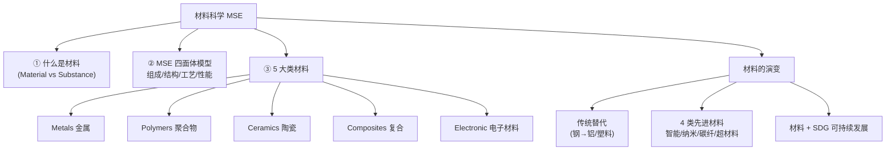

# 材料科学导论 / Introduction to Materials Science

> [!NOTE]
> **本节定位**
> - **位置**: Week 1,L01(CME223 整门课的"开门",Test 在 Week 6 = 5/15 上午)
> - **前置知识**: 高中化学(原子、化学键、元素周期表)
> - **本节核心**: 三件事 — ① 材料 vs 物质的区别;② 用什么模型分析材料(**MSE 四面体**);③ 材料分哪 5 大类
> - **后续联系**: L02 原子结构与键合 → L03 晶体结构与缺陷,本节是后面所有内容的"鸟瞰图"

---

## 知识结构

---

## 知识块 1 — 课程行政信息(考核与日程)

**Assessment**(总分 100%):

| 项目 | 占比 | 时间 |
|---|---|---|
| **Test** | 20% | Week 6 = **2026/5/15 (Fri) 10:00-12:00** |
| Assignment 1(Group) | 15% | Week 8 截止 = 5/29 11:59 pm |
| Assignment 2(Group) | 15% | Week 13 截止 = 7/3 11:59 pm |
| **Final Exam** | 50% | Week 16 或 17 |

**14 周课表**(关键节点):

| 周 | 主题 |
|---|---|
| 1 | Introduction to materials science(本讲) |
| 2 | Atomic structure and bonding |
| 3-4 | Crystal structures I & II |
| 5,7 | Chemical properties of metals I & II |
| **6** | **Test** |
| 8 | Materials selection for equipment design |
| 9 | Ceramics |
| 10-11 | Polymers I & II |
| 12-13 | Corrosion and oxidation I & II |
| 14 | Engineering alloy + Revision |

**主要教材**(三本任选):
1. Smith & Hashemi (2019) *Foundations of Materials Science and Engineering* (6th ed.) — McGraw Hill
2. Askeland & Wright (2019) *Essentials of Materials Science and Engineering* (4th ed.) — Cengage
3. Callister & Rethwisch (2020) *Materials Science and Engineering* (9th ed.) — Wiley

---

## 知识块 2 — 为什么要学材料科学

材料学的"存在感"来自三个层面:

**(1) 经济意义** — 材料的生产和处理占经济总量很大一块,工程师选错材料 = 产品没竞争力。

**(2) 技术驱动** — 新应用往往需要新材料:
- **医疗**:髋关节置换 → 需要生物相容 + 高强度 + 长寿命的金属/陶瓷
- **能源**:太阳能板(将光能 → 电能)、电动车电池
- **航天/交通**:直升机叶片和机身用复合材料(强但轻)

**(3) 性能改造** — 现有材料经过处理也能"换性格":
- *Heat treatment*(热处理)→ 改强度/韧性
- *Composite formation*(复合化)→ 综合多种材料优点

**特殊场景的极限挑战**:空间站和火星车要在太空恶劣条件下工作 → 需要 *high-temperature resistant materials*(高温耐受材料)。

> [!TIP]
> **延伸(非 PPT 内容)**
> "选材就是选权衡":材料学家不是"找最好的材料",而是"找在给定约束下最合适的材料"。这个思路贯穿后面所有章节。

---

## 知识块 3 — 材料 vs 物质:两个常被搞混的词

PPT 里给了精确定义,容易搞混,先把这层弄清:

| 词 | 定义 | 例子 |
|---|---|---|
| **Material 材料** | 任何**有质量有体积**,由 1 种或多种 substance 构成 | 水、混凝土、铁、铜、空气 |
| **Substance 物质** | **化学组成恒定**、特征性质恒定的纯物质 | 水、铁、铜(单一化学式) |

**关键区别**:**所有 substance 都是 material,但 material 不一定是 substance**。
- 铁块 → 既是 material 也是 substance(化学组成单一)
- 混凝土 → 是 material(有质量有体积),不是 substance(由水泥/沙/水/钢筋多种 substance 组成)

**材料的来源**:地壳 + 大气
- 地壳质量比:**Si 27.7%,Fe 5%**(这两个是材料学的"主角")
- 干燥空气体积比:**N 78%,O 21%**

---

## 知识块 4 — Materials Science vs Engineering:三框关系

材料科学(MS)、材料工程(ME)、材料科学与工程(MSE)三个词常被混用,但其实有分工:

*（此处为课件截图，未收录）*
> 三框图:Materials Science(基础认知)+ Materials Engineering(应用)→ MSE(把结构/性质的认知作为产物)

| 概念 | 核心动作 | 关心什么 |
|---|---|---|
| **Materials Science** | **研究** | 材料**内部**的结构、性质、加工方式(基础知识) |
| **Materials Engineering** | **应用** | 把上述知识变成**外部**的器件/产品/结构(手机、飞机、汽车) |
| **MSE** | **研究 + 应用** | 内 ↔ 外的桥梁;输出是"结构-性质"的连贯认知 |

**记忆口诀**:Science 看里(结构/性质),Engineering 看外(应用),MSE 把"内"导向"外"。

**MSE 的正式定义**(必记):
> Materials Science and Engineering(MSE)is an **interdisciplinary** field that studies and manipulates **composition** and **structure** of materials to control materials **properties** through **synthesis** and **processing**.

里面 4 个高频词:
- *composition* = 化学组成(material 是由什么元素/化合物组成)
- *structure* = 原子排列(原子怎么排在空间里)
- *synthesis* = 合成(用天然或人造化学品做出材料)
- *processing* = 加工(把材料塑造成有用的零件)

---

## 知识块 5 — MSE 的灵魂:四面体模型

这一节是整门课的核心。后面所有讲的内容,都可以挂到这个模型上。

*（此处为课件截图，未收录）*
> MSE 四面体:4 顶点 + 中心,以汽车板钢应用为例

四面体的 **4 个顶点 + 1 个中心**,每个都对应一类问题:

| 顶点位置 | 关注 | 工程师在问什么(以汽车板钢为例) |
|---|---|---|
| **顶 — Performance/Cost** | 性能-成本比 | 强度-密度比?可成形性?抗撞击?制造成本? |
| **A — Composition** | 化学组成 | 铁基?铝基?加什么合金元素?加多少? |
| **B — Microstructure** | 微观结构 | 哪些结构特征决定了强度和可成形性? |
| **C — Synthesis & Processing** | 合成 + 加工 | 怎么控制工艺让钢同时坚韧又可成形? |
| **中心 — Characterization** | 表征 | 把上述四个顶点的数据**测出来** |

**关键洞察**(必背):
> *The composition, structure and synthesis-processing are all interconnected and affect the performance-to-cost ratio.*

也就是说:**改任何一个顶点,其他三个都会跟着变**。选材是个"四向折中"问题。

> [!TIP]
> **延伸(非 PPT 内容)**
> 这个模型在化工里有完美对应——化工的"PFD/PID 三角"也讲反应/分离/换热相互耦合。MSE 四面体就是"材料版 PFD"。学化工的同学应该容易理解。

---

## 知识块 6 — 5 大类材料(本课的"分类系统")

按 elemental composition(化学组成)+ crystallinity(结晶度)+ bonding type(键型)分:

### 6.1 Metals 金属

**特征**:
- 由 1 种或多种**金属元素**组成(可能也含非金属元素如 C/O,如 SiC、Fe₂O₃)
- 一般是**晶体**结构(原子排列有序)
- **导电导热好**
- 致密、强、刚、有延展性、有金属光泽

**分类**(Metals and Alloys):

*（此处为课件截图，未收录）*
> 金属合金分两支:Ferrous 含铁基(钢、铸铁);Nonferrous 不含铁基(铜、铝)

**例**:Fe、Cu、Al、Au。

### 6.2 Polymers 聚合物(塑料/橡胶)

**特征**:
- 大部分是**有机分子**、**非晶**(或半晶)
- **绝缘**(导电性差)→ 用作电气绝缘
- 强度和延展性**因品种差异极大**
- **密度低**、**热分解温度低**(不耐高温)
- **抗腐蚀好**

**例**:PVC、polyester。
**应用**:水管(plumbing)、CD(polycarbonate)、头盔、瓶子、微波炉部件。

### 6.3 Ceramics 陶瓷

**特征**:
- 金属 + 非金属元素**化学键合**
- 可晶体可非晶可混合
- **硬、强、耐磨**
- **绝缘**且耐高温 → 用于熔炼炉衬、航天器隔热(再入大气层)
- 例:**TiO₂、SiO₂、Si₃N₄、Al₂O₃**、瓷器、玻璃、黏土

**应用**:磨料、建材、混凝土。

### 6.4 Composites 复合材料

**定义**:两种或更多材料结合,获得**单一材料无法兼具**的性能。
- 由 *filler*(填料)+ *binder*(基体)组成
- 两种材料只**键合**,不互溶

*（此处为课件截图，未收录）*
> 复合材料三角图:三个顶点是 Metals/Polymers/Ceramics,中心是 Composites,三条边各举一例

**两大类**:
| 类型 | 结构 |
|---|---|
| **Fibrous** | 纤维分散在基体中 |
| **Particulate** | 颗粒分散在基体中 |

基体可以是 metal、ceramic 或 polymer。

**经典例子**(对应三角图三条边):
- **Steel-cord tyres**(轮胎钢丝帘)= metals + polymers
- **Wire-reinforced cement**(钢筋混凝土)= metals + ceramics
- **Carbon fibre reinforced polymer (CFRP)**(碳纤增强聚合物)= polymers + ceramics

**应用**:飞机翼、建筑结构。

*（此处为课件截图，未收录）*
> 大型运输机的复合材料分布:Carbon、Carbon/Aramid、Aramid、Glass 四类按部位分别使用

### 6.5 Electronic Materials 电子材料

**特征**:
- 代表是**硅(Si)**
- 通过**掺杂(doping)**改变电学性质
- 例:芯片、电容器
- **应用**:计算机、IC、卫星

### 三类对比快查(Metals/Ceramics/Polymers)

| 维度 | Metals | Ceramics | Polymers |
|---|---|---|---|
| 元素 | 金属为主(Fe/Al/Cu/Au) | 金属+非金属(氧化物/碳化物/氮化物) | 长链有机分子 |
| 强度 | 强 + 刚 + 可延展 | **强但脆** | 软,强度低 |
| 导电导热 | **高** | 几乎不导 | **低** |
| 高温 | 较好 | **极好** | **不耐** |
| 密度 | 高 | 中 | **低** |
| 化学惰性 | 一般 | 好 | **极好** |

---

## 知识块 7 — 强度 vs 重量比 数据表

| Material | Strength (kg/m²) | Density (g/cm³) | Strength-to-weight ratio (cm) |
|---|---|---|---|
| Polyethylene | 70 × 10⁴ | 0.83 | 8.43 × 10⁴ |
| Pure aluminum | 455 × 10⁴ | 2.71 | 16.79 × 10⁴ |
| Al₂O₃ | 21 × 10⁶ | 3.16 | 0.67 × 10⁵ ⚠️ |
| Epoxy | 105 × 10⁵ | 1.38 | 7.61 × 10⁵ |
| Heat-treated alloy steel | 17 × 10⁷ | 7.75 | 0.22 × 10⁷ |
| Heat-treated aluminum alloy | 60 × 10⁶ | 2.71 | 2.21 × 10⁶ |
| Carbon-carbon composite | 42 × 10⁶ | 1.80 | 2.33 × 10⁶ |
| Heat-treated titanium alloy | 12 × 10⁷ | 4.43 | 0.27 × 10⁷ |
| Kevlar-epoxy composite | 46 × 10⁶ | 1.38 | 3.13 × 10⁶ |
| Carbon-epoxy composite | 56 × 10⁶ | 1.38 | 4.06 × 10⁶ |

> [!WARNING]
> **PPT 数据有疑**
> **Al₂O₃** 那行 ratio 写成 `0.67 × 10⁵`,但按公式 `21×10⁶ / 3.16 ≈ 6.65×10⁶`,数量级低一个。PPT 原图就是这个值,**疑为教材笔误**,按原文保留。考试如果出这道题以课件为准。

**笔记里要看的趋势**:复合材料(Carbon-epoxy、Kevlar-epoxy)的 ratio **比纯金属高一个量级**——这就是飞机为什么越来越多用复合材料。

---

## 知识块 8 — 材料的竞争与替代

> *Materials compete with each other to exist in new market.*

**驱动两条**:
1. **Cost-performance** 权衡 — 谁便宜又好用,谁就胜出
2. **技术突破** — 新材料一旦突破,会替代老材料

*（此处为课件截图，未收录）*
> 美国汽车 1985-1997 平均每辆车的材料用量(lb/Car):钢/铁在降,铝/塑料在升

**1985 → 1997 美国汽车平均每辆**(读图):
| 材料 | 1985 | 1997 | 趋势 |
|---|---|---|---|
| **Steel 钢** | ~1600 lb | ~1350 lb | ↓ 但仍主导 |
| **Iron 铁** | ~450 lb | ~250 lb | ↓ 明显 |
| **Plastic 塑料** | ~300 lb | ~400 lb | ↑ |
| **Aluminum 铝** | ~150 lb | ~280 lb | ↑ 翻倍 |

**1997 年现代汽车的材料地图**:

*（此处为课件截图，未收录）*
> 现代汽车几乎每个部件都对应一种材料创新:从 graphene 润滑剂到 carbon air filter 到 composite materials,12 处标注

> [!NOTE]
> 这张图里的"Carbon air filter"标注出现了两次(原 PPT 排版错误,不是 OCR 问题)。

---

## 知识块 9 — 4 类先进材料(Recent Advances and Future Trends)

### 9.1 Smart Materials 智能材料

*（此处为课件截图，未收录）*
> SMP 形状记忆循环:永久形 → 变形+冷却 → 暂时形 → 加热 → 回到永久形

**定义**:能感知外部刺激(温度/水/光)并改变性质的材料。
**典型例子**:
- **Shape Memory Polymers (SMPs)** — 形状记忆聚合物,用于穿戴舒适服装
- **Piezoelectric materials**(压电材料)— 受力发电、通电变形;用于传感器和减振器

### 9.2 Nanomaterials 纳米材料

*（此处为课件截图，未收录）*
> 碳纳米纤维的 SEM 图:可以看到交错的纳米纤维网络

**定义**:粒径 **< 100 nm** 的材料。
**特性**:在小尺度下出现独特的光、电、磁、机械性质。
**经典例子**:**Carbon nanofiber-reinforced plastic** — 比金属还强但极轻。
**研究方向**:这是讲师标注的"potential research field"——**值得跟读的方向**。

### 9.3 Carbon Fiber Reinforced Plastics (CFRP)

**特征**:连续碳纤维 + 有机基体 → 极轻 + 极强。
**前驱体来源**:rayon、polyacrylonitrile (PAN)、pitch。
**应用**:航空(空客 A350)、航天、运输。

### 9.4 Metamaterials 超材料

*（此处为课件截图，未收录）*
> 左杯普通水里吸管按预期偏折;右杯 metamaterial 介质里吸管反向折射(负折射率视觉效果)

**定义**:经过工程设计的、自然界没有的性质的材料(如**负折射率**)。
**典型应用**:**电磁隐身斗篷**(让物体对电磁辐射不可见)。
**实现方式**:亚波长结构阵列(如 Split-Ring Resonator)排列。

---

## 知识块 10 — 材料 + 可持续发展(SDG)

*（此处为课件截图，未收录）*
> 从 plant biomass(纤维素 / Lignin / Plant chemicals)→ 先进材料 → 绿色技术 → "Better human life"——这张图把材料学挂到 UN SDG 的关联

**关联 UN SDGs**:
- 中心 **SDG 9**(产业、创新与基础设施)
- 顶部:SDG 1(无贫困)、SDG 2(零饥饿)、SDG 8(体面工作和经济增长)、SDG 10(减少不平等)
- 右下 **SDG 12**(负责任消费与生产)

**两条产出路径**:
- **Green technology / eco-system**:Bio-based products / Biorefinery / Biofuel / Water treatment / Medical materials
- **Advanced materials**:Bioplastics / Composite material / Analytical probe / Functional chemicals / Bio-based industries / Waste recycles

---

## 对比与总结

**5 类材料 + 4 类先进材料一图记忆表**:

| 类别 | 关键特征 | 标志性应用 | 笔记里的代表图 |
|---|---|---|---|
| Metals | 晶体 / 导电 / 强韧 | 钢、铝、铜 — Ferrous vs Nonferrous | p17 |
| Polymers | 长链有机 / 绝缘 / 轻 | PVC 水管、PC CD、头盔 | — |
| Ceramics | 离子+共价键 / 硬而脆 / 耐高温 | 瓷器、玻璃、Al₂O₃、SiO₂ | — |
| Composites | 两种合一 / 取长补短 | 钢筋混凝土、CFRP、玻璃钢 | p22, p21 |
| Electronic | Si 主导 / 掺杂改性 | IC 芯片、卫星电子 | — |
| **Smart** | 感知刺激 → 改变性质 | SMP、压电 | p27 |
| **Nano** | < 100 nm | 碳纳米纤维 | p28 |
| **CFRP** | 碳纤维 + 高分子 | 空客 A350 | — |
| **Meta** | 自然没有的性质 | 隐身斗篷、负折射 | p30 |

---

## 本节引入的核心概念

- 材料 Material
- 物质 Substance
- MSE 四面体
- Composition 化学组成
- Structure 原子排列
- Microstructure 微观结构
- Synthesis 合成
- Processing 加工
- Characterization 表征
- Performance-to-Cost 性能成本比
- 金属 Metals
- Ferrous vs Nonferrous
- 聚合物 Polymers
- 陶瓷 Ceramics
- 复合材料 Composites
- Fibrous vs Particulate composites
- 电子材料 Electronic Materials
- Doping 掺杂
- Strength-to-weight ratio 强重比
- Smart Materials 智能材料
- Shape Memory Polymer SMP
- Piezoelectric Materials 压电材料
- Nanomaterials 纳米材料
- CFRP 碳纤增强聚合物
- Metamaterials 超材料
- Negative Refractive Index 负折射率

---

## 我的疑问

> [!NOTE]
> 1. **MSE 四面体的"中心"到底是什么**?Slide 16 缩略图标 *Properties*,Slide 17 大图标 *Microstructure / Characterization*,Slide 17 文字描述又强调 "performance-to-cost"——三处不一致,以哪个为准?
> 2. **强度表里 Al₂O₃ 那行的数量级笔误**(0.67×10⁵ vs 计算值 ~10⁶)是讲师/教材笔误还是有特殊单位换算?考试出题怎么对待?
> 3. **复合材料三角图的"金属-陶瓷"边**举的"Wire-reinforced cement"——工业里这是把钢筋(金属)加到水泥(陶瓷)里,但这跟"钢筋混凝土"是不是一回事?
> 4. **SMP 循环图里那个红 X 标的路径**(直接从 deformed temporary shape → 加热 → 永久形)想强调什么?是说"加热不能直接恢复",还是说"加热应该走绿色路径而不是这个红 X 路径"?
> 5. **电子材料只举了 Si**——那 GaAs、GaN、Ge 等 III-V/IV 族半导体怎么归类?和 Si 在 MSE 四面体上有什么不同?

---

## 个人补充

> [!NOTE]
> **我的理解**
> (留给自己上课听到、跟其他课联系到的内容)
