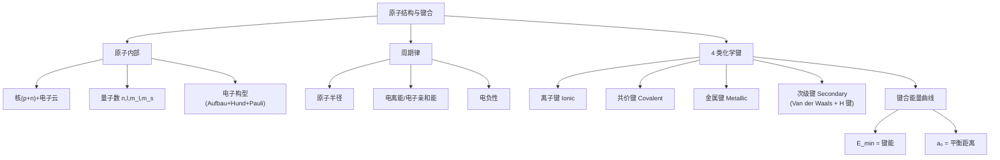

# 原子结构与键合 / Atomic Structure and Bonding

> [!NOTE]
> **本节定位**
> - **位置**: Week 2,L02(58 页主体 + 9 页 examples)
> - **前置知识**: L01 的 5 大类材料分类(本节解释"为什么金属导电、为什么聚合物绝缘"的微观原因)
> - **本节核心**: ① 原子的内部结构 + 量子数;② 电子构型与周期律;③ **4 类化学键**(离子/共价/金属/次级)
> - **后续联系**: L03 晶体结构 = 把这些键合放进 3D 周期格子里

---

## 知识结构



---

## 知识块 1 — Learning Outcomes(5 件事)

讲完本节,你应该能:

1. 识别电子的**量子数**(n / l / m_l / m_s)
2. 解释元素在**周期表**中的排列原因
3. 理解元素的**电子构型**
4. 解释**电负性**在键合中的作用
5. 区分材料中的**键合机制**(4 类)

---

## 知识块 2 — 原子发现史(时间线)

| 年代 | 人物 | 贡献 |
|---|---|---|
| 17 世纪 | Robert Boyle | 元素由"simple bodies"组成 |
| 19 世纪初 | John Dalton | 物质由小颗粒(atoms)组成 |
| 19 世纪末 | Henri Becquerel + Marie & Pierre Curie | 提出**放射性** |
| 1897 | J. J. Thompson | 发现**电子**(阴极射线管实验) |
| 1910 | Ernest Rutherford | 发现**质子**(α 粒子散射实验) |
| 1932 | James Chadwick | 发现**中子** |

**Rutherford 散射实验**(1910)的关键发现:
- 大部分 α 粒子**直接穿过**金箔 → 原子内部大部分是**空的**
- 极少数 α 粒子被**反弹** → 正电荷集中在**很小的区域**(就是核)

> [!TIP]
> **延伸(非 PPT 内容)**
> Rutherford 模型把"梅子布丁模型"改写成"行星模型",但 Bohr 在 1913 年又指出"行星模型"的电子轨道不能连续——必须**量子化**才能解释氢原子光谱。这就引出了下面的量子论。

---

## 知识块 3 — 原子结构(数据汇总)

整页数据全在这张图里(MinerU 完全没抽出文字):

*（此处为课件截图，未收录）*
> ATOM(直径 10⁻¹⁰ m,中性) = Nucleus + Electron Cloud

| 组分 | 直径 / 质量 | 电荷 |
|---|---|---|
| **Atom** | 10⁻¹⁰ m | 中性 |
| **Nucleus** 核 | 10⁻¹⁴ m,占几乎全部质量 | **+** |
| **Electron Cloud** 电子云 | 占全部体积,m_e = 9.109×10⁻²⁸ g | -1.602×10⁻¹⁹ C |
| **Proton** 质子 | m_p = 1.673×10⁻²⁴ g | +1.602×10⁻¹⁹ C |
| **Neutron** 中子 | m_n = 1.675×10⁻²⁴ g | 中性 |

**记忆点**:核占质量但只占 **10⁻⁴** 的尺度——电子云是原子"大小"的来源。

---

## 知识块 4 — 原子序数 / 质量数 / 同位素

- **Atomic Number Z** = 核内**质子数**(每个元素独有)
- **Mass Number A** = 核内 **质子数 + 中子数**
- **Avogadro Number** $N_A = 6.023 \times 10^{23}$
- **One gram mole** = gram atomic mass(克原子量)
- **Isotope 同位素** = 同 Z 但 A 不同(如 ¹²C 和 ¹³C)

**例**:Carbon Z=6,有 6 protons + 6 neutrons → A = 12,one gram mole = 12 g 含 6.023×10²³ 个 C 原子。

### Example 1 — wt% 转 atomic %(经典题)

> 100 g Ni-Cu 合金,75 wt% Cu + 25 wt% Ni。问 Cu/Ni atom%?
> 已知:Cu 摩尔质量 63.54 g/mol;Ni 摩尔质量 58.69 g/mol。

**思路**:wt% → 摩尔数(用 n = m/M_r)→ 摩尔分数 → atom%。

*（此处为课件截图，未收录）*
> 讲师手写解:n_Cu = 75/63.54 = 1.1804 mol;n_Ni = 25/58.69 = 0.4260 mol

$$n_{total} = 1.1804 + 0.4260 = 1.6064 \text{ mol}$$
$$\text{atom\%}_{Cu} = \frac{1.1804}{1.6064} \times 100\% = \boxed{73.48\%}$$
$$\text{atom\%}_{Ni} = \frac{0.4260}{1.6064} \times 100\% = \boxed{26.52\%}$$

### Example 2 — wt% 转分子式

> 镍铝化合物 NiₓAlᵧ,42.04 wt% Ni + 57.96 wt% Al,求最简整数式。

取 100 g 基准:
$$n_{Ni} = \frac{42.04}{58.69} = 0.7160 \text{ mol}$$
$$n_{Al} = \frac{57.96}{26.98} = 2.148 \text{ mol}$$

> [!WARNING]
> **数据踩坑提醒**
> MinerU 抽出来时把 0.**7**160 错识成 0.**1**160 — 笔记里以正确值 **0.7160** 为准。

**摩尔比**: Ni : Al = 0.7160 : 2.148 = **1 : 3** → 最简式 **NiAl₃**。

---

## 知识块 5 — Planck 量子论 + Bohr 模型

### Planck 量子论(1900)

能量只能以**离散单位 quanta** 发射或吸收:

$$E = h\nu = \frac{hc}{\lambda}$$

其中 h = Planck 常数 = **6.63×10⁻³⁴ J·s**,c = 光速 = 3×10⁸ m/s。

> [!WARNING]
> **OCR 修正**
> MinerU 把希腊字母 ν(nu,频率)抽成了 υ(upsilon)。笔记里全部用 ν。

*（此处为课件截图，未收录）*
> 电磁波谱:X-ray / UV / Visible / IR / Microwave / Radio,波长越短 → 频率越高 → 能量越大

### Bohr 氢原子模型(1913)

3 条核心:
1. 电子只在**确定能级**(壳层)上运动
2. 吸收能量 → 升级;释放能量 → 降级
3. 跃迁能量差 $\Delta E = \frac{hc}{\lambda}$

*（此处为课件截图，未收录）*
> 三联图:吸光升级(Absorb)→ 高能态 → 释光降级(Emit)

**氢原子能量公式**:

$$E_n = -\frac{13.6}{n^2} \text{ eV},\quad n = 1, 2, 3, \ldots$$

n = principal quantum number(主量子数)。

### Example: 跃迁能 n=3 → n=2

$$\Delta E = -\frac{13.6}{3^2} - \left(-\frac{13.6}{2^2}\right) = -1.51 + 3.40 = \boxed{1.89 \text{ eV}}$$

(PPT 上 round 成 1.81 eV,以课件值为准考试)

**Ionization Energy 电离能**:把电子从基态(n=1)拉到无穷远(n=∞)所需的能量,氢原子是 13.6 eV。

---

## 知识块 6 — 4 个量子数

每个电子由 4 个量子数完全描述:

| 符号 | 名称 | 取值 | 物理含义 |
|---|---|---|---|
| **n** | Principal 主 | 1, 2, 3, ..., 7 | 主能级 / 壳层(K, L, M, N, ...) |
| **l** | Subsidiary 副 | 0, 1, ..., n-1 | 亚层(s=0, p=1, d=2, f=3) |
| **m_l** | Magnetic 磁 | -l, ..., 0, ..., +l | 轨道方向 |
| **m_s** | Spin 自旋 | ±½ | 电子自旋 |

*（此处为课件截图，未收录）*
> n 决定主壳层(K/L/M),l 决定亚壳层(s/p/d/f)

### Table 2.1 — 每壳的电子容量

| n | Shell | 亚层 | 状态数 | 每亚层电子数 | **每壳总电子数 = 2n²** |
|---|---|---|---|---|---|
| 1 | K | s | 1 | 2 | **2** |
| 2 | L | s, p | 1, 3 | 2, 6 | **8** |
| 3 | M | s, p, d | 1, 3, 5 | 2, 6, 10 | **18** |
| 4 | N | s, p, d, f | 1, 3, 5, 7 | 2, 6, 10, 14 | **32** |

---

## 知识块 7 — 杂化轨道(Hybrid Orbitals)

杂化把 s 和 p 轨道混合,产生更对称的成键轨道:

| 杂化 | 轨道数 | 几何形状 | **键角** |
|---|---|---|---|
| sp | 2 | 直线 Linear | **180°** |
| sp² | 3 | 平面三角 Trigonal Planar | **120°** |
| **sp³** | 4 | 四面体 Tetrahedral | **109.5°** |
| sp³d | 5 | 三角双锥 Trigonal Bipyramidal | 90° + 120° |
| sp³d² | 6 | 八面体 Octahedral | **90°** |

*（此处为课件截图，未收录）*
> sp³ 四面体杂化:4 个等价轨道,键角 109.5°(碳/金刚石/CH₄ 都用这个)

---

## 知识块 8 — 电子构型(Electron Configuration)

### 三大规则

1. **Aufbau 原理**:电子先填能量低的轨道
2. **Pauli 不相容**:每个轨道最多 2 个电子,自旋反平行(↑↓)
3. **Hund 规则**:简并轨道先各填 1 个 ↑,再配对

### Aufbau 对角填充顺序

*（此处为课件截图，未收录）*
> 对角箭头方向:从右上到左下读

填充顺序:**1s → 2s → 2p → 3s → 3p → 4s → 3d → 4p → 5s → 4d → 5p → 6s → 4f → 5d → 6p → 7s → ...**

### 构型符号读法

*（此处为课件截图，未收录）*
> 符号 1s² 2s² 2p⁶ 3s² 中:数字=主量子数 / 字母=亚层 / 上标=电子数

**例**:Iron (Z=26) 的电子构型 = $1s^2\,2s^2\,2p^6\,3s^2\,3p^6\,3d^6\,4s^2$

### Hund 规则可视化(Orbital Box, 用 C 为例)

碳(Z=6) 基态构型 1s² 2s² 2p²:

```
1s: [↑↓]    2s: [↑↓]    2p: [↑] [↑] [ ]
```

**Hund**:2p 的两个电子各占一个轨道(都自旋向上)而不挤进同一个轨道。这让原子能量最低。

> [!WARNING]
> **OCR 修正**
> p21 的 orbital box 箭头被 MinerU 完全丢失。笔记里用 ASCII 箭头还原。

### 多电子原子的能级反转

*（此处为课件截图，未收录）*
> 核心反常:**4s 能量低于 3d**,所以 K(Z=19) 把电子填进 4s 而不是 3d

物理原因:**屏蔽效应**——内层电子屏蔽核电荷,外层电子感受到的"有效核电荷"小于真实核电荷。同 n 时 s < p < d < f(s 钻入核更近,受到屏蔽小)。

### 阳离子的电子构型(修正 PPT 笔误)

> [!WARNING]
> **OCR 修正**
> MinerU 把 "2p⁶" 误识成 "sp⁶"(漏了主量子数 2)。笔记里全部修正。

正确构型:
- **Fe**:$1s^2\,2s^2\,2p^6\,3s^2\,3p^6\,3d^6\,4s^2$
- **Fe²⁺**(失 4s 两个电子):$1s^2\,2s^2\,2p^6\,3s^2\,3p^6\,3d^6$
- **Fe³⁺**(再失 1 个 3d 电子):$1s^2\,2s^2\,2p^6\,3s^2\,3p^6\,3d^5$

**规则**:形成阳离子时**先脱外层(高 n)再脱内层**——4s 先于 3d。

---

## 知识块 9 — 周期表与周期律

*（此处为课件截图，未收录）*
> 完整周期表:主族 IA-VIIIA + 过渡族 IB-VIIB+VIII + 镧/锕系

### 4 个周期律(across rows / down columns)

| 性质 | 沿周期向右 | 沿族向下 |
|---|---|---|
| **原子半径** | ↓(电荷增 → 收缩) | ↑(壳层增) |
| **第一电离能** | ↑ | ↓ |
| **电子亲和能** | 整体 ↑(到 16/17 族最高) | ↓ |
| **电负性** | ↑ | ↓ |

*（此处为课件截图，未收录）*
> 主族原子半径(pm):H=37 / Cs=265 / Ne=70(数值 + 圆圈大小可视化)

*（此处为课件截图，未收录）*
> 第一电离能 3D 柱状图:惰性气体(He/Ne/Ar)最高,碱金属最低

### Electronegativity 电负性(Pauling 标度)

*（此处为课件截图，未收录）*
> 电负性数轴:K=0.9 → Na=1 → H=2.1 → N=3 → O=3.5 → **F=4.1**(最大)

**电负性差** $|\chi_A - \chi_B|$ **决定键合类型**:
- 差 > 1.7 → **离子键**
- 差 ~0.5-1.7 → **极性共价键**
- 差 < 0.5 → **非极性共价键**(纯共享)
- 差 ≈ 0(同元素)→ **金属键 / 非极性共价**

### Metals / Metalloids / Nonmetals(简单分类)

- **Metals**:左 + 中(IA-IIA + 过渡)
- **Metalloids**:斜线带(B / Si / Ge / As / Sb / Te)
- **Nonmetals**:右上(F/O/N/Cl/...)

---

## 知识块 10 — 化学键 4 大类总览

| 类型 | 形成机制 | 典型材料 | 键能量级 (kJ/mol) |
|---|---|---|---|
| **Ionic** | 金属(失 e)+ 非金属(得 e),静电吸引 | NaCl, MgO | 600-1500 |
| **Covalent** | 原子间共享电子对 | 金刚石 C-C, H₂O, F₂ | 150-1000 |
| **Metallic** | 金属阳离子 + 离域电子海 | Fe, Cu, Al | 100-800 |
| **Secondary** | 偶极-偶极弱吸引 | He(冷凝), 水冰 H 键 | 0.1-50 |

---

## 知识块 11 — 离子键(Ionic Bonding)

### 形成机制

*（此处为课件截图，未收录）*
> 流程:Electropositive(给电子)→ Cation⁺ + Electronegative(收电子)→ Anion⁻ → 静电吸引 → IONIC BOND

**经典例**:Na (1s² 2s² 2p⁶ 3s¹) + Cl (1s² 2s² 2p⁶ 3s² 3p⁵) → Na⁺ + Cl⁻ → NaCl

### Coulomb 力 / 能量

**两离子间**:

$$F_{net}(a) = -\frac{Z_1 Z_2 e^2}{4\pi\varepsilon_0 a^2} - \frac{nb}{a^{n+1}}$$

第一项 = **吸引**(异号电荷),第二项 = **排斥**(电子云重叠)。

平衡距离 a₀ 处 F = 0,对应能量曲线极小:

*（此处为课件截图，未收录）*
> Energy vs interionic distance:吸引(虚线下沉)+ 排斥(虚线陡升)= 净能(实线 V 形),底部 E_min = -键能

**关键数据**:
- $a_0 = r_{cation} + r_{anion}$(两离子半径之和)
- $E_{min}$ = 键能,需要这么多能量才能把键打开
- e = 1.60×10⁻¹⁹ C
- ε₀ = 8.85×10⁻¹² C²/(N·m²)

### Example 3 — Mg²⁺-S²⁻ 离子半径

> Mg²⁺ 与 S²⁻ 平衡时引力 F = 1.49×10⁻⁸ N。已知 r(S²⁻) = 0.184 nm,求 (a) a₀,(b) r(Mg²⁺)。

**(a)** 反解 Coulomb 律:

$$a_0 = \sqrt{-\frac{Z_1 Z_2 e^2}{4\pi\varepsilon_0 F}} = \sqrt{-\frac{(+2)(-2)(1.60\times 10^{-19})^2}{4\pi(8.85\times 10^{-12})(1.49\times 10^{-8})}} = 2.49\times 10^{-10} \text{ m}$$

$$\boxed{a_0 = 0.249 \text{ nm}}$$

**(b)** 由 $a_0 = r_{Mg^{2+}} + r_{S^{2-}}$:

$$r_{Mg^{2+}} = 0.249 - 0.184 = \boxed{0.065 \text{ nm}}$$

### Example 4 — NaCl 键能 E_min

> NaCl 离子对:r(Na⁺) = 0.095 nm,r(Cl⁻) = 0.181 nm,平衡排斥力 F_rep = -3.02×10⁻⁹ N(题目),n = 9。
> 求 (a) 排斥常数 b,(b) 键能 E_min。

平衡距离 $a_0 = 0.095 + 0.181 = 0.276 \text{ nm} = 2.76\times 10^{-10}$ m。

**(a)** 由 $F_{rep} = -\frac{nb}{a^{n+1}}$,讲师代入用 -3.20×10⁻⁹ N(PPT 内不一致,**题目-3.02 vs 解答-3.20**,以课件解答为准):

$$b = 8.59\times 10^{-106} \text{ N·m}^{10}$$

**(b)** 总能量:

$$E_{NaCl} = \frac{Z_1 Z_2 e^2}{4\pi\varepsilon_0 a_0} + \frac{b}{a_0^n}$$
$$= \frac{(+1)(-1)(1.60\times 10^{-19})^2}{4\pi(8.85\times 10^{-12})(2.76\times 10^{-10})} + \frac{8.59\times 10^{-106}}{(2.76\times 10^{-10})^9}$$
$$= -8.34\times 10^{-19} + 0.92\times 10^{-19} = \boxed{-7.42\times 10^{-19} \text{ J}}$$

> [!WARNING]
> **课件笔误:Example 4**
> 题目原文 F = -3.02×10⁻⁹ N,解答代入用 -3.20×10⁻⁹ N(0/2 互换)。考试以课件解答为准。

---

## 知识块 12 — 共价键(Covalent Bonding)

### 形成机制

外层 s 和 p 电子**共享**,达到稀有气体构型。发生在**电负性差小**的原子之间。

*（此处为课件截图，未收录）*
> H + H → H-H,两个 1s 电子云重叠形成共价键(Overlapping Electron Clouds)

### Bond Order vs Bond Energy(关键数据)

*（此处为课件截图，未收录）*
> F₂:共享 1 对电子,**Bond order = 1**,**键能 = 160 kJ/mol**

*（此处为课件截图，未收录）*
> O₂:共享 2 对电子(双键),**Bond order = 2**,**键能 = 498 kJ/mol**

*（此处为课件截图，未收录）*
> N₂:共享 3 对电子(三键),**Bond order = 3**,**键能 = 945 kJ/mol**

> [!WARNING]
> **OCR 修正**
> 这 3 个数(160/498/945 kJ/mol)MinerU 完全没抽出 — 必须从图里读。Bond order 数字也丢了。

**规律**:**Bond order ↑ → bond length ↓ → bond energy ↑**

### Polar vs Nonpolar Covalent

| 类型 | 电子共享 | 例 |
|---|---|---|
| Nonpolar | 完全均等共享 | H₂, F₂, N₂(同元素) |
| Polar | 偏向高电负性的一边 | HF, H₂O, CH₃Cl |

### Table 2.6 — 常见共价键能与键长

| 键 | Bond Energy (kJ/mol) | Bond Length (nm) |
|---|---|---|
| C-C | 370 | 0.154 |
| C=C | 680 | 0.13 |
| C≡C | 890 | 0.12 |
| C-H | 435 | 0.11 |
| O-H | 500 | 0.10 |
| C-O | 360 | 0.14 |

### 碳的杂化与 sp³

*（此处为课件截图，未收录）*
> 碳 1s² 2s² 2p² 提升 1 个 2s 电子到 2p → 4 个未配对电子 → 形成 sp³ 杂化(4 个等价四面体轨道,键角 109.5°)→ 可与 4 个原子成 4 个键

### 金刚石(Diamond)

*（此处为课件截图，未收录）*
> 金刚石:每个 C 通过 sp³ 与 4 个邻 C 形成共价键,扩展成 3D 四面体网络

| 性质 | 数值 |
|---|---|
| 键能 | **711 kJ/mol** |
| 熔点 | **3550 °C**(极高) |
| 硬度 | 自然界最硬 |

### 含碳分子的特性(CH₄ 例)

CH₄(甲烷):
- C 形成 4 个共价键(sp³ 四面体)
- **分子内**键能高,**分子间**键能低(只有 Van der Waals)
- 因此熔点极低 = **-183 °C**

碳还能形成单键 / 双键 / 三键(与 C 自身或与 N/O 等):
- 乙烯 H₂C=CH₂(双键)
- 乙炔 H-C≡C-H(三键)

### 苯环(Benzene C₆H₆)

- 6 个 C 排成 **hexagonal**(六边形)环
- 单 / 双键交替(实际是 π 电子离域,等价键长)

### 离子键 vs 共价键 对比

*（此处为课件截图，未收录）*
> NaF(纯离子,晶体堆叠球)vs F₂(纯共价,双原子球对)vs HF(极性共价,中间态)

---

## 知识块 13 — 金属键(Metallic Bonding)

### 电子海模型

*（此处为课件截图，未收录）*
> 绿色正离子有序排列 + 弥散的"价电子海"在原子间自由移动

5 条核心:
1. 金属原子在晶体中**紧密堆积**
2. 价电子(valence electrons)被多个原子**共同吸引**
3. 这些电子**自由移动**形成"电子海"(sea of electrons)
4. 自由电子是**导电、导热**的原因
5. 金属键**无方向性** → 可锻、可延展

### Table 2.8 — 第 4 周期金属的键能与熔点

| 元素 | 电子构型 | 键能 (kJ/mol) | 熔点 (°C) |
|---|---|---|---|
| K | 4s¹ | 89.6 | 63.5 |
| Ca | 4s² | 178 | 851 |
| Cr | 3d⁵ 4s¹ | 398 | 1903 |
| **Fe** | 3d⁶ 4s² | **418** | **1535** |
| Ni | 3d⁸ 4s² | 423 | 1453 |
| Cu | 3d¹⁰ 4s¹ | 339 | 1083 |
| Zn | 3d¹⁰ 4s² | 130 | 419 |

**规律**:**价电子越多 + 金属键百分比越高 → 键能、熔点越高**(到 Fe/Ni 是 d 电子参与最强,然后下降)。

### 金属的可塑性

*（此处为课件截图，未收录）*
> 金属变形:外力施加,正离子滑动重排,电子海重新分布——键合不被打破

**为什么金属可锻**:无方向性键合,正离子可滑动,电子海"跟着流"。
**为什么纯金属软**:可通过**合金化**(加入异种原子)增强 → 后面 L05/L07 的"金属化学性质"细讲。

---

## 知识块 14 — 次级键(Secondary Bonding)

源于**电偶极**之间的弱静电吸引。键能远低于主键(0.1-50 kJ/mol)。

### 偶极矩

*（此处为课件截图，未收录）*
> 电偶极 = 一对 ±q 相隔距离 d:**μ = q · d**(方向从 -q 指向 +q)

### 三类次级键

**(1) Fluctuating Dipole 涨落偶极**(也叫 London 色散力)

*（此处为课件截图，未收录）*
> 对称分布(瞬间)

*（此处为课件截图，未收录）*
> 不对称分布(瞬间偏移,产生瞬时偶极)

惰性气体(He/Ne/Ar)和非极性分子之间的弱键 — 电子云**瞬间不对称分布**产生临时偶极,诱导邻居也偏移,产生吸引。

**(2) Permanent Dipole 永久偶极**

由分子结构**永久不对称**产生:
- **CH₄** → 4 个 C-H 对称排列 → **无偶极**(净矩 = 0)
- **CH₃Cl** → 1 个 C-Cl + 3 个 C-H 不对称 → **永久偶极**

**(3) Hydrogen Bond 氢键**(最强的次级键)

*（此处为课件截图，未收录）*
> 水分子间的氢键(橙色双向箭头):每个 H₂O 通过 O-H...O 与邻居相连

**形成条件**:含 H 的极性键(O-H, N-H, F-H)+ 邻近高电负性原子(O, N, F)。

**水分子的氢键**:水分子键角 ~105°(略小于 109.5° 的四面体,因为孤对电子排斥更强),分子间通过 O-H...O 形成网络 → 这是水**反常物性**(高沸点、冰浮于水)的根源。

### Fluctuating vs Permanent 对比表

| 特征 | Fluctuating Dipole | Permanent Dipole |
|---|---|---|
| 定义 | 临时诱导偶极 | 永久偶极矩 |
| 形成 | 邻居影响 / 电子云瞬时偏移 | 由分子内电负性差产生 |
| 稳定性 | 瞬时(随时间变化) | 永久(条件稳定时) |
| 力的名称 | London 色散力 | Dipole-Dipole 相互作用 |

---

## 对比与总结

### 4 类化学键最终总览

| 类型 | 机制 | 方向性 | 键能 (kJ/mol) | 决定的材料性质 |
|---|---|---|---|---|
| **Ionic** | 电子转移 + 静电 | 无 | 600-1500 | 硬、脆、绝缘、高熔点 |
| **Covalent** | 共享电子对 | **强** | 150-1000 | 硬、脆、绝缘、高熔点 |
| **Metallic** | 电子海 | 无 | 100-800 | 强、韧、导电导热、可锻 |
| **Secondary** | 偶极吸引 | 弱 | 0.1-50 | 低熔点、易挥发、可压缩 |

回顾 L01:这就是为什么金属导电(电子海)、聚合物绝缘且低熔点(分子间次级键)、陶瓷脆且耐高温(强离子/共价键不可滑动)。

---

## 本节引入的核心概念

- 原子 Atom
- 质子 / 中子 / 电子
- 原子序数 Z
- 质量数 A
- 同位素 Isotope
- 摩尔 / Avogadro Number
- Planck 量子论
- Bohr 原子模型
- 氢原子能级 E_n = -13.6/n²
- 电离能 Ionization Energy
- 主量子数 n
- 副量子数 l
- 磁量子数 m_l
- 自旋量子数 m_s
- 杂化轨道 Hybrid Orbitals (sp / sp² / sp³ / sp³d / sp³d²)
- Aufbau 原理
- Hund 规则
- Pauli 不相容
- 屏蔽效应
- 周期表 Periodic Table
- 原子半径 Atomic Radius
- 电子亲和能 Electron Affinity
- 氧化数 Oxidation Number
- 电负性 Electronegativity (Pauling 标度)
- 离子键 Ionic Bond
- 共价键 Covalent Bond
- 金属键 Metallic Bond
- 次级键 Secondary Bond
- 键能 Bond Energy
- 平衡距离 a₀
- Coulomb 力
- Bond Order
- Polar / Nonpolar Covalent
- sp³ 杂化与金刚石
- 电子海 Electron Sea
- 偶极矩 μ = q·d
- London 色散力
- 氢键 Hydrogen Bond

---

## 我的疑问

> [!NOTE]
> 1. **电子海模型**说"价电子自由移动",但金属里电子真的"自由"吗?能带理论(band theory)和电子海有什么区别?哪个更准确?
> 2. **氢键键能** 20-50 kJ/mol,跟离子/共价低一个量级,但水的反常物性那么明显——是因为氢键"数量多"吗?有多少个 H₂O 同时形成氢键?
> 3. **Example 4 的 -3.02 vs -3.20**:讲师 PPT 自身就不一致,考试万一考到这种数据,以题目还是解答为准?
> 4. **杂化轨道是真的存在还是数学构造**?sp³ 这个概念是计算工具(混合 s 和 p)还是真有"物理上的 sp³ 轨道"?
> 5. **为什么 K(Z=19) 把第 19 个电子填进 4s 而不是 3d**?屏蔽效应是定性解释,有没有定量计算可以让我自己算"4s 比 3d 低多少 eV"?
> 6. **Mg²⁺ 半径 0.065 nm**(Example 3 的结果)和教材表里查的 Mg²⁺ 离子半径(通常 ~0.072 nm)有差异,Example 3 的简化模型有多准?
> 7. **电负性差 1.7** 是离子/共价分界值,这个数字怎么定的?像 NaCl 的电负性差是 2.1(纯离子),但 HCl 是 0.96(应是极性共价),那 1.7 这个边界有什么物理意义?

---

## 个人补充

> [!NOTE]
> **我的理解**
> (留给上课/做题时记下来的内容)
