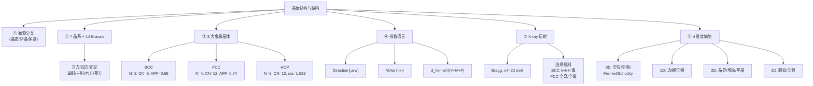

# 晶体结构与晶体缺陷 / Crystal Structures and Crystal Defects

> [!NOTE]
> **本节定位**
> - **位置**: Week 3,L03(88 页主体 + 30 页 Example 1-9,**Test 在 Week 6 = 5/15**)
> - **前置知识**: L02 的 4 类化学键(本节是把这些键放进 3D 周期格子里)
> - **本节核心**: ① 7 晶系 + 14 Bravais 格子;② 3 大金属晶体 BCC/FCC/HCP;③ Direction [uvw] + Miller (hkl) 指数;④ X-ray 衍射 + Bragg 定律;⑤ 4 维度晶体缺陷
> - **后续联系**: L04+ 化学性质 / L05 选材 / L08+ 腐蚀都依赖本节的"晶体 + 缺陷"语言

---

## 知识结构

---

## 知识块 1 — Learning Outcomes(7 件事)

讲完本节,你应该能:
1. 学会原子和离子如何在固体中排列,识别**基本构件**
2. 区分 **FCC / BCC / HCP** 三种晶体结构
3. 定义这些结构里**原子的空间关系**
4. 识别**密堆积平面和方向**
5. 识别和使用**晶向 / 晶面的 Miller 指数**
6. 描述衍射仪的 **X-ray 衍射图**
7. 解释**晶体缺陷**

---

## 知识块 2 — 固体的微观分类(三大类)

按**长程有序度**分:

| 类型 | 长程有序? | 典型 | 例子 |
|---|---|---|---|
| **Crystalline** 晶态 | ✓ 完整 LRO | 单一连续晶格 | 石英、金刚石、食盐 |
| **Polycrystalline** 多晶 | 段内有序 | 由许多小晶粒+晶界组成 | 大多数金属 |
| **Amorphous** 非晶 | ✗ 仅短程有序 SRO | 原子位置随机 | 玻璃、塑料、橡胶 |

*（此处为课件截图，未收录）*
> 一图全:Single Crystal(晶态/连续 LRO)/ Polycrystalline(多晶/小晶粒+晶界)/ Amorphous(非晶/SRO 玻璃)

**关键性质差异**:
- Crystalline → 有**确定熔点**(distinct melting point)
- Amorphous → 在一个温度范围内软化(**glass transition** 玻璃化转变)

> [!TIP]
> **延伸(非 PPT 内容)**
> "晶态 vs 非晶"决定材料宏观性质:为什么金属电阻低(电子海 + 周期格子让电子畅通);为什么玻璃透明且脆(无周期不能引导位错滑动)。本节的"晶格"语言贯穿整门课。

---

## 知识块 3 — 7 大晶系 + 14 Bravais 格子

任何 3D 晶体都可归到 **7 个晶系**(根据 a、b、c 和 α、β、γ 的对称关系):

| 晶系 | 边长 | 角度 |
|---|---|---|
| **Cubic** 立方 | **a = b = c** | **α = β = γ = 90°** |
| **Tetragonal** 四方 | a = b ≠ c | α = β = γ = 90° |
| **Orthorhombic** 正交 | a ≠ b ≠ c | α = β = γ = 90° |
| **Hexagonal** 六方 | a = b ≠ c | α = β = 90°,**γ = 120°** |
| **Rhombohedral**(也叫 Trigonal)菱方 | a = b = c | α = β = γ ≠ 90° |
| **Monoclinic** 单斜 | a ≠ b ≠ c | α = γ = 90° ≠ β |
| **Triclinic** 三斜 | a ≠ b ≠ c | α ≠ β ≠ γ ≠ 90° |

> [!WARNING]
> **OCR 修正**
> MinerU 把"Trigonal"识成了"5 onal","Triclinic"识成了"Triclini"。笔记里全部修正。

按 **Bravais (1811-1863)** 的分类,这 7 个晶系再组合成 **14 种 Bravais 格子**(增加体心 / 面心 / 底心几种变体)。

*（此处为课件截图，未收录）*
> Bravais 七系彩色轮盘:Cubic / Tetragonal / Orthorhombic / Hexagonal 等

立方系 3 种变体:
- **Simple cubic (SC)** — 8 个角原子
- **Body-centered cubic (BCC)** — 8 角 + 1 体心
- **Face-centered cubic (FCC)** — 8 角 + 6 面心

---

## 知识块 4 — 3 大金属晶体结构(本节灵魂)

> 90% 的金属采用 **BCC / FCC / HCP** 三种之一。

### 4.1 Body-Centered Cubic (BCC)

*（此处为课件截图，未收录）*
> BCC 几何:体对角线 = 4R = √3a;面对角线 = √2a;边长 = a

| 量 | 公式 / 值 |
|---|---|
| **每单胞原子数** N | **8 × 1/8(角)+ 1(体心)= 2** |
| **配位数** CN | **8** |
| **a-R 关系** | **a = 4R/√3**(原子在体对角线上接触) |
| **APF** | **0.68** |

**APF 推导**:
$$\text{APF}_{BCC} = \frac{V_{atoms}}{V_{cell}} = \frac{2 \times \frac{4}{3}\pi R^3}{(4R/\sqrt{3})^3} = \frac{\frac{8\pi R^3}{3}}{\frac{64 R^3}{3\sqrt{3}}} = \frac{\pi\sqrt{3}}{8} \approx 0.68$$

**典型 BCC 金属**:Cr(a=0.289 nm)、Fe(a=0.287 nm)、Na(a=0.429 nm)、Li、K、V、W、Mo、Ta。

### 4.2 Face-Centered Cubic (FCC)

*（此处为课件截图，未收录）*
> FCC 几何:面对角线 = 4R = √2a → **a = 2√2 R**

| 量 | 公式 / 值 |
|---|---|
| **每单胞原子数** N | **8 × 1/8(角)+ 6 × 1/2(面心)= 4** |
| **配位数** CN | **12** |
| **a-R 关系** | **a = 4R/√2 = 2√2 R**(原子在面对角线上接触) |
| **APF** | **π/(3√2) ≈ 0.74**(自然界最密堆积之一) |

**典型 FCC 金属**:Al(a=0.405 nm)、Au(a=0.408 nm)、Cu、Ag、Ni、Pt、Pb、γ-Fe(高温铁)。

### 4.3 Hexagonal Close-Packed (HCP)

| 量 | 公式 / 值 |
|---|---|
| **每单胞原子数** N | **(2 × 6 × 1/6)+(2 × 1/2)+ 3 = 6** |
| **配位数** CN | **12** |
| **a-R 关系** | **a = 2R**(基面相邻原子接触) |
| **理想 c/a** | **1.633** |
| **APF** | **π/(3√2) ≈ 0.74**(与 FCC 相同,都是 close-packed) |

**典型 HCP 金属**:Zn(a=0.2665 nm,c/a=1.85)、Co(a=0.2507,c/a=1.62)、Mg、Ti、Be、Cd。

> [!TIP]
> **延伸:为什么 FCC 和 HCP 的 APF 相同?**
> 因为它们都是 **close-packed structures** — 球填充密度都是 74%,数学上达到 3D 球堆积上限(Kepler 1611,2014 才严格证明)。区别只在堆叠顺序:**FCC = ABCABC,HCP = ABABAB**。

### 4.4 三结构对比(关键考点)

| 性质 | BCC | FCC | HCP |
|---|---|---|---|
| N(原子/单胞) | 2 | 4 | 6 |
| CN | 8 | **12** | **12** |
| a 与 R | 4R/√3 | 2√2 R | 2R |
| APF | 0.68 | **0.74** | **0.74** |
| 密堆积? | 否 | **是**(ABC) | **是**(ABA) |
| 例子 | Fe(α)、Cr | Cu、Al、γ-Fe | Zn、Mg、Ti |

---

## 知识块 5 — FCC vs HCP 堆叠(ABA vs ABC)

*（此处为课件截图，未收录）*
> HCP = **ABA** 堆叠(第 3 层回到 A 位置,与第 1 层对齐)

*（此处为课件截图，未收录）*
> FCC = **ABC** 堆叠(第 3 层在新的 C 位置,3 层后才回到 A)

**直观理解**:堆橘子 → 第 2 层放在第 1 层的"凹陷"上(b void) → 第 3 层有两种放法:
- 放回 a 位 = **HCP**(每层 2 选 1 凹陷)
- 放在不同的 c 位 = **FCC**(每层选另一种凹陷)

---

## 知识块 6 — 立方晶胞中原子的位置坐标

立方晶胞 8 个角点和 1 个体心的位置坐标(以单胞边长为单位距离):

| 位置 | 坐标 (x, y, z) |
|---|---|
| 8 个角点 | (0,0,0)、(1,0,0)、(0,1,0)、(0,0,1)、(1,1,0)、(0,1,1)、(1,0,1)、(1,1,1) |
| 体心 | **(1/2, 1/2, 1/2)** |
| 面心(FCC) | (1/2, 1/2, 0)、(1/2, 0, 1/2)、(0, 1/2, 1/2)、... |

PPT 约定:y 轴向右、x 轴出纸面、z 轴向上(注意非常规)。

---

## 知识块 7 — Direction Indices [uvw]

### 算法(5 步)

*（此处为课件截图，未收录）*
> 求方向 [uvw] 的标准流程:终点-起点 → 化整 → 加 bar(若负)→ 用方括号

1. 画方向矢量,直到从立方单元表面射出
2. 确定**射出点和起点**的坐标
3. **终点 - 起点** = (Δx, Δy, Δz)
4. 是否都为整数?否则乘以最小整数
5. 是否有负值?是则加 **bar**(上划线);用 **方括号 [uvw]** 包起来

### 例:从 (3/4, 0, 1/4) 到 (1/4, 1/2, 1/2)

$$(1/4, 1/2, 1/2) - (3/4, 0, 1/4) = (-1/2, 1/2, 1/4)$$
$$\times 4 \rightarrow (-2, 2, 1) \rightarrow \boxed{[\bar{2}21]}$$

### 等价方向 ⟨uvw⟩

立方对称性下,某些方向等价:
$$\langle 100 \rangle = [100], [010], [001], [\bar{1}00], [0\bar{1}0], [00\bar{1}]$$

---

## 知识块 8 — Miller Indices (hkl) — 晶面

### 算法(6 步)

*（此处为课件截图，未收录）*
> 求平面 (hkl) 标准流程:截距 → 倒数 → 化整 → bar → 圆括号

1. 选一个**不过原点**的平面(否则截距全为 0)
2. 确定该面与 x、y、z 轴的**截距**
3. 求**截距的倒数**
4. 有分数?乘最小整数化整
5. 有负值?加 bar
6. 用 **圆括号 (hkl)** 包起来

### 例:三个标准面

*（此处为课件截图，未收录）*
> 立方体的三个标准面:粉=(100),黄=(010),绿=(001)

| 截距 | 倒数 | Miller 指数 |
|---|---|---|
| (1, ∞, ∞) | (1, 0, 0) | **(100)** |
| (∞, 1, ∞) | (0, 1, 0) | **(010)** |
| (∞, ∞, 1) | (0, 0, 1) | **(001)** |

### 例:(632) 平面

$$\text{截距} = (1/3, 2/3, 1) \rightarrow \text{倒数} = (3, 3/2, 1) \rightarrow \times 2 \rightarrow \boxed{(632)}$$

### 等价面族 {hkl}

立方:$\{100\} = (100), (010), (001), (\bar{1}00), (0\bar{1}0), (00\bar{1})$ 共 6 个等价面。

### 重要关系:面间距 d_hkl

立方系最近邻平行 (hkl) 面之间的距离:

$$\boxed{d_{hkl} = \frac{a}{\sqrt{h^2 + k^2 + l^2}}}$$

并且:**[hkl] 方向⊥(hkl) 面**(立方系特有的关系,其他晶系不一定)。

---

## 知识块 9 — Hexagonal: Miller-Bravais 4 指数 (hkil)

六方系**单独引入** 4 指数 [uvtw] / (hkil) 体系,因为 3 指数下等价方向不显眼。

约定:
- **i = -(h + k)**(冗余指数)
- 4 个轴:a₁、a₂、a₃(基面三个 120° 互成的轴)、c(垂直 c 轴)

*（此处为课件截图，未收录）*
> 六方坐标系:a₁/a₂/a₃ 互成 120°,加垂直 c 轴

### 例:六方典型面

| 面 | 截距 (a₁, a₂, a₃, c) | (hkil) |
|---|---|---|
| Top basal(顶面) | ∞, ∞, ∞, 1 | **(0001)** |
| Prism ABCD(棱柱) | 1, ∞, -1, ∞ | **(10̄10)** |

---

## 知识块 10 — 原子密度(Atomic Density)

三种密度:

| 类型 | 公式 | 单位 |
|---|---|---|
| **Volume density** $\rho_v$ | 单胞质量 / 单胞体积 | Mg/m³ 或 g/cm³ |
| **Linear density** $\rho_l$ | (方向上选定长度内的原子数) / 长度 | atoms/m 或 atoms/nm |
| **Planar density** $\rho_p$ | (平面上选定面积内的原子中心数) / 面积 | atoms/m² |

### 例:Cu (FCC) 体积密度

> Cu (FCC),原子量 63.54 g/mol,a = 0.3615 nm。求密度。

$$V = a^3 = (3.615 \times 10^{-10})^3 = 4.724 \times 10^{-29} \text{ m}^3$$
$$m_{cell} = \frac{4 \times 63.54}{6.022 \times 10^{23}} = 4.220 \times 10^{-22} \text{ g} = 4.220 \times 10^{-28} \text{ Mg}$$
$$\rho = \frac{m}{V} = \boxed{8.933 \text{ Mg/m}^3 = 8.933 \text{ g/cm}^3}$$

### 例:FCC Cu [110] 线密度

a = 0.361 nm,[110] 截 2×½ + 1 = 2 atoms,长度 = a√2:
$$\rho_l = \frac{2}{a\sqrt{2}} = \frac{2}{0.510 \text{ nm}} = \boxed{3.92 \text{ atoms/nm}}$$

### 例:Fe BCC (110) 面密度

a = 0.287 nm,(110) 面是矩形 a × a√2,4×¼ + 1 = 2 atoms:
$$\rho_p = \frac{2}{a^2 \sqrt{2}} \approx \boxed{1.72 \times 10^{13} \text{ atoms/mm}^2}$$

---

## 知识块 11 — Polymorphism(同质多形)

> 同一种金属在不同温度/压力下可以采用**不同的晶体结构**。

**典型例**:**铁(Iron)**:
- α-Fe(BCC)< 912°C
- γ-Fe(FCC)912-1394°C
- δ-Fe(BCC)1394-1538°C
- 液态 Fe > 1538°C

*（此处为课件截图，未收录）*
> 铁的相变温度色谱图(BCC ↔ FCC ↔ BCC ↔ Liquid)

> [!TIP]
> **延伸:这是钢铁热处理的物理基础**
> 钢铁加热到 γ 区(FCC,溶碳能力高)→ 快冷淬火 → 锁住碳形成马氏体(强但脆)→ 回火调整。整个钢铁工艺以 BCC↔FCC 转变为基础。

---

## 知识块 12 — X-ray 衍射(XRD)

### Mo X-ray 源

钼靶被电子轰击后产生:
- **Kα 线**(L→K 跃迁,约 0.07 nm)— 主要使用
- **Kβ 线**(M→K 跃迁)
- 连续辐射(轫致辐射)

X-ray 单色处理后,选 Kα 作为单色光打到晶体上。

### 同相 vs 异相干涉

*（此处为课件截图，未收录）*
> 特定角度入射,反射 X-ray 同相 → **增强束**(reinforced beam)— 这就是衍射

任意角度入射 → 反射异相 → 互相抵消 → 无衍射束。

### Bragg 定律(本节皇冠公式)

*（此处为课件截图，未收录）*
> Bragg 几何:Ray 1, Ray 2 在 (hkl) 面间反射,路径差 = 2d sinθ

入射 X-ray 在两个相邻 (hkl) 面之间反射,路径差 MP+PN = 2d sinθ。**衍射条件**(同相):

$$\boxed{n\lambda = 2 d_{hkl} \sin\theta}$$

n = 衍射级数(通常取 1)。

### 立方晶 d_hkl

$$d_{hkl} = \frac{a}{\sqrt{h^2 + k^2 + l^2}}$$

代入 Bragg:
$$\sin^2\theta = \frac{\lambda^2 (h^2 + k^2 + l^2)}{4 a^2}$$

> [!WARNING]
> **OCR 修正**
> MinerU 把 λ²(波长平方)抽成单字符 ƛ。笔记里全部修回 λ²。

### 衍射仪 / 粉末法

*（此处为课件截图，未收录）*
> 测角仪:粉末样品 + 探测器在 0°-120° 圆周扫描,记录 2θ vs intensity

### 选择规则(衍射什么不衍射什么)

| 晶体 | 反射存在 | 反射消失 |
|---|---|---|
| **BCC** | h+k+l = **偶数** | h+k+l = 奇数 |
| **FCC** | h, k, l **全奇 或 全偶** | 部分奇部分偶 |

### 用 sin²θ 比判定 BCC vs FCC

两个相邻衍射峰 A、B,Bragg 公式相除:

$$\frac{\sin^2\theta_A}{\sin^2\theta_B} = \frac{h_A^2 + k_A^2 + l_A^2}{h_B^2 + k_B^2 + l_B^2}$$

按选择规则,**前两个**衍射面:
- BCC:{110} 和 {200} → **比值 = 2/4 = 0.5**
- FCC:{111} 和 {200} → **比值 = 3/4 = 0.75**

*（此处为课件截图，未收录）*
> 未知金属判定流程:测前两个峰的 2θ → 算 sin²θ_A/sin²θ_B → 0.5 = BCC,0.75 = FCC

### Table 3.7 — 立方系 Miller 指数衍射对应

| {hkl} | h²+k²+l² | FCC | BCC |
|---|---|---|---|
| {100} | 1 | — | — |
| {110} | 2 | — | **(110)** |
| **{111}** | 3 | **(111)** | — |
| **{200}** | 4 | **(200)** | **(200)** |
| {210} | 5 | — | — |
| **{211}** | 6 | — | **(211)** |
| **{220}** | 8 | **(220)** | **(220)** |
| {221} | 9 | — | — |
| **{310}** | 10 | — | **(310)** |

**关键观察**:FCC 第一峰是 {111}(h²+k²+l² = 3),BCC 第一峰是 {110}(h²+k²+l² = 2)。

### Example 10:从 XRD 算 BCC 铁的晶格常数

> BCC 铁,λ = 0.1541 nm,{110} 面在 θ = 44.704° 衍射,n=1。求 a。

由 Bragg: $\lambda = 2 d \sin\theta$:
$$d_{110} = \frac{\lambda}{2 \sin\theta} = \frac{0.1541}{2 \times \sin 44.704°} = \frac{0.1541}{2 \times 0.7034} = 0.1095 \text{ nm}$$

由 $d = a/\sqrt{h^2+k^2+l^2}$,{110} 时 √2:
$$a = d \times \sqrt{2} = 0.1095 \times 1.414 = \boxed{0.1549 \text{ nm}}$$

(注:课件原值 BCC Fe a ≈ 0.287 nm,本例数据可能是简化值,以课件给出的解为准)

### Example 11(自练):识别未知元素

> 衍射峰位 2θ = 40, 58, 73, 86.8, 100.4, 114.7°,λ = 0.154 nm。求 (a) 晶体结构 (b) a (c) 元素。

思路:算前两个 sin²θ 比 → 0.5 BCC 还是 0.75 FCC → 用 Bragg 算 a → 查附录表对应元素。

---

## 知识块 13 — 非晶材料(Amorphous Materials)

三类典型:
1. **Polymers** 聚合物 — 长链分子,次级键不允许凝固时形成有序排列;有些是**半结晶**(semi-crystalline)。
2. **Glass** 玻璃 — 由 SiO₄⁴⁻ 四面体组成,流动性受限,凝固时来不及形成晶格。
3. **Metallic Glass** 金属玻璃 — 极快冷却(~10⁸ K/s)抑制结晶,得到非晶结构,具优异机械/磁学性能。

---

## 知识块 14 — 晶体缺陷(4 维度分类)

> Defects are imperfections that disrupt what would otherwise be a perfect lattice.

按维度:

| 维度 | 类型 | 例 |
|---|---|---|
| **0D Point** | Vacancy / Interstitial / Substitutional / Schottky / Frenkel | 单点扰动 |
| **1D Line** | Edge / Screw dislocation | 沿一条线的扰动 |
| **2D Surface** | Grain boundary / Stacking fault / Twin boundary | 平面状扰动 |
| **3D Volume** | Crack / Void / Inclusion / Amorphous region | 体积块缺陷 |

### 14.1 0D 点缺陷

*（此处为课件截图，未收录）*
> Vacancy(空位):正常位置上少了一个原子

*（此处为课件截图，未收录）*
> Substitutional impurity(置换杂质):异种原子替换主原子位置

*（此处为课件截图，未收录）*
> Interstitial impurity(间隙杂质):小的异种原子挤进原子之间的空隙

**离子晶体特有的两类**:

*（此处为课件截图，未收录）*
> **Frenkel defect**:阳离子离开正常位置进入间隙,形成"空位+间隙"对。**密度不变**(原子总数不变)。

*（此处为课件截图，未收录）*
> **Schottky defect**:成对的阳/阴离子空位(保持电中性)。**密度降低**(原子总数减少)。

### 14.2 1D 线缺陷(位错 Dislocations)

位错 = 完美晶体中两个区域之间的边界,沿一条线扭曲。**Burgers vector b** 描述扭曲的大小和方向。

*（此处为课件截图，未收录）*
> Edge dislocation 边位错:多出来一排原子(extra row of atoms / extra half-plane)。**b ⊥ 位错线**。

*（此处为课件截图，未收录）*
> Screw dislocation 螺位错:晶面螺旋上升。**b ∥ 位错线**。

> [!TIP]
> **延伸(非 PPT 内容)**
> 位错是金属塑性变形的关键:外力 → 位错滑动 → 宏观可塑。如果位错被钉死(合金原子、晶界、其他位错)→ 材料硬化。这是冷加工硬化、合金强化、退火软化的物理本质。

### 14.3 2D 面缺陷

*（此处为课件截图，未收录）*
> Grain boundary 晶界:相邻晶粒(取向不同)的交界处,几个原子直径厚的"扭曲带"。能量比晶粒内部高。

*（此处为课件截图，未收录）*
> Stacking fault 堆垛层错:正常 FCC 是 ABCABC,但中间漏一层 C 变成 ABC|BC ABC,即 missing C-layer。

*（此处为课件截图，未收录）*
> Twin boundary 孪晶界:中线两侧晶格互为**镜像**。

*（此处为课件截图，未收录）*
> 机械孪晶形成:完美晶体 → 施加剪应力 → 镜像重排

### 14.4 3D 体积缺陷

*（此处为课件截图，未收录）*
> 3D 体缺陷:裂纹(crack)/ 空洞(void)/ 夹杂(inclusion)/ 非晶区

**裂纹形成机制**:
1. **晶体生长热梯度**(快冷 → 应力 → 淬火裂纹)
2. **外应力**(机械负载 → 裂纹萌生 → 解理面扩展)
3. **离子晶体静电不匹配**(层间错位 → 排斥 → 裂纹)

---

## 对比与总结

### 三大金属晶体快查

| | BCC | FCC | HCP |
|---|---|---|---|
| N | 2 | 4 | 6 |
| CN | 8 | 12 | 12 |
| a-R | 4R/√3 | 2√2 R | 2R(c=1.633a) |
| APF | 0.68 | 0.74 | 0.74 |
| 堆叠 | — | ABC | ABA |
| 例 | α-Fe, Cr | Cu, Al, γ-Fe | Zn, Mg, Ti |

### Direction vs Plane 指数算法对比

| | Direction [uvw] | Plane (hkl) |
|---|---|---|
| 起点 | 矢量端点坐标 | 平面与轴的截距 |
| 操作 | 终点-起点 | 截距倒数 |
| 化整 | 乘以最小整数 | 乘以最小整数 |
| 负值 | 加 bar | 加 bar |
| 包号 | **方括号 [uvw]** | **圆括号 (hkl)** |
| 等价 | ⟨uvw⟩(尖括号) | {hkl}(花括号) |

### XRD 选择规则

| 晶体 | h+k+l 偶 | h, k, l 全奇/全偶 | 第一峰 | sin²θ_A/sin²θ_B |
|---|---|---|---|---|
| BCC | ✓ | — | (110) | **0.50** |
| FCC | — | ✓ | (111) | **0.75** |

---

## 本节引入的核心概念

- Crystalline 晶态
- Polycrystalline 多晶
- Amorphous 非晶
- Glass Transition 玻璃化转变
- Lattice 格子
- Lattice Translation Vector
- Unit Cell 单胞
- Long Range Order LRO
- Short Range Order SRO
- 7 大晶系
- 14 Bravais 格子
- Cubic / Tetragonal / Orthorhombic
- Hexagonal / Rhombohedral / Monoclinic / Triclinic
- BCC / FCC / HCP
- Coordination Number CN
- Atomic Packing Factor APF
- Close-Packed Structure
- ABC vs ABA Stacking
- Polymorphism / Allotropy
- Direction Indices [uvw]
- Miller Indices (hkl)
- Miller-Bravais (hkil)
- d_hkl 面间距
- Volume / Linear / Planar Density
- X-ray Diffraction XRD
- Bragg's Law
- Selection Rule(BCC / FCC)
- Vacancy 空位
- Substitutional Impurity 置换
- Interstitial Impurity 间隙
- Frenkel Defect
- Schottky Defect
- Edge Dislocation 边位错
- Screw Dislocation 螺位错
- Burgers Vector
- Grain Boundary 晶界
- Stacking Fault 堆垛层错
- Twin Boundary 孪晶界
- Volume Defect 体缺陷

---

## 我的疑问

> [!NOTE]
> 1. **APF = 0.74 真的是 3D 球堆积的最大值吗**?这是 Kepler 1611 年猜的,2014 年才严格证明。但 BCC 是 0.68 — 那随机紧密堆积(RCP)的 0.64 是不是说"球瞎堆"也接近 BCC 的有序堆积?
> 2. **HCP 的 c/a = 1.633 是怎么算出来的**?用几何应该能推:基面三角形的高 + 第二层球落在中心。课件给了数值但没推导。
> 3. **Miller 指数 [hkl] ⊥ (hkl) 面**只在立方系成立,**其他晶系**(六方/四方/正交/三斜)就不成立了 — 那这些晶系怎么求方向和面的关系?
> 4. **Schottky 缺陷"密度降低"**(原子数减少)— 但晶体的体积也会随之收缩吗?还是体积保持只是质量减?
> 5. **金属玻璃**说 10⁸ K/s 才能冷成非晶 — 这种冷速实际怎么实现?是用 melt-spinning 把熔体甩成薄带吗?
> 6. **位错的 Burgers vector** 怎么测?课件说"闭合矢量"但没画 Burgers circuit 详细图。
> 7. **Example 4** 的 [3̄ 2 1̄] 在课件 markdown 里抽成 "[3 2 1]"(漏了 bar)— 考试如果题目让你画 [3̄21̄],我应该能从图里看出 bar 是哪些位吗?
> 8. **BCC vs FCC 哪个更稳定**?Fe 在低温是 BCC、高温(912-1394°C)变 FCC、再高温(1394-1538°C)又回 BCC — 这个不单调是为什么?
> 9. **Schottky 与 Frenkel 严格说不是"间隙缺陷"**,但课件 Slide 80 把它们都归到"Point Defects - Interstitial Impurity"标题下。这是 PPT 的分类问题,考试以哪个为准?

---

## 个人补充

> [!NOTE]
> **我的理解**
> (留给上课/做题时记下来的内容)
