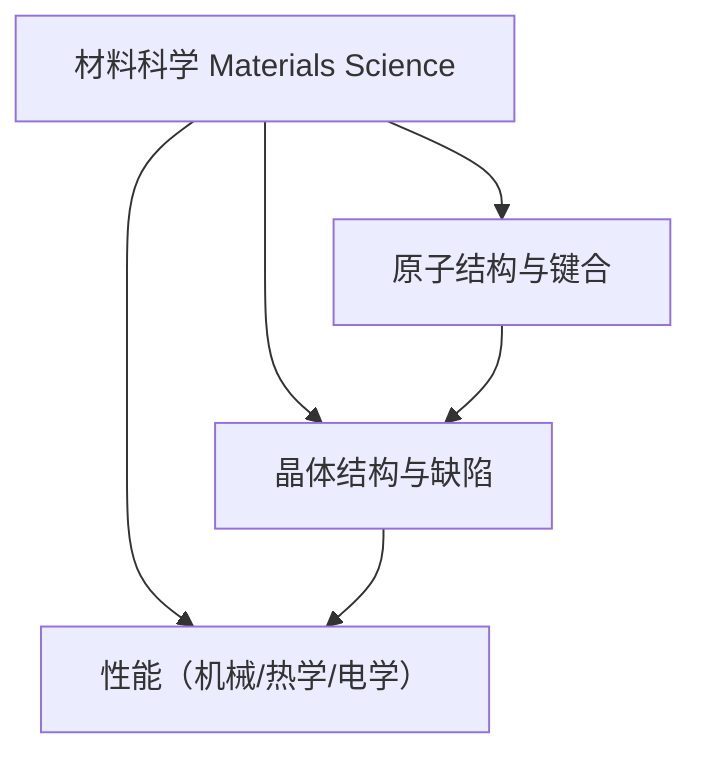

# CME223 材料科学 / Materials Science

> [!NOTE]
> **课程概览**
> - **学期**: 2026 Spring（开学 2026/04，Test Week 6 = 2026/5/15）
> - **课程代码**: CME223
> - **核心主题**: 材料的原子结构、键合、晶体结构与缺陷,以及它们如何决定材料性能

---

## 课程地图

---

## 各周笔记

<!-- ingest-lecture skill 会按周 append 段落到这里 -->

## Week 1

第一讲是开门铺垫:把"什么是材料"和"怎么分析材料"两件事讲清楚。核心是 **MSE 四面体**(组成/结构/工艺/性能 4 个顶点 + 中心表征),整门课后面的内容都挂这个模型上。然后给出 **5 大类材料**(金属/聚合物/陶瓷/复合/电子)的特征对比和典型应用,以及 **4 类先进材料趋势**(智能/纳米/碳纤/超材料)+ 材料 ↔ SDG 关联。

- [L01 — 材料科学导论](L01_intro_to_materials_science.md)

**本周疑问**:
- MSE 四面体"中心"到底是 *Properties* / *Microstructure* / *Characterization* 哪个?课件三处不一致
- 强度表里 Al₂O₃ 行 ratio `0.67×10⁵` vs 计算值 ~10⁶,到底是 PPT 笔误还是单位换算?考试以哪个为准?
- 电子材料只讲了 Si — 那 GaAs/GaN/Ge 这些 III-V 族半导体怎么归类?

## Week 2

第二讲是材料学的"微观底层":先把原子结构 + 4 个量子数 + 电子构型(Aufbau/Hund/Pauli)讲清楚,然后用周期律(原子半径/电离能/电负性)铺垫**化学键的 4 大类**:**离子(Coulomb)/共价(电子共享)/金属(电子海)/次级(偶极 + 氢键)**。58 页主体 + 9 页 examples,信息密度大但都为后面服务——L03 晶体结构本质上是把这些键放进 3D 周期格子里。

- [L02 — 原子结构与键合](L02_atomic_structure_bonding.md)

**本周疑问**:
- 电子海模型 vs 能带理论 — 哪个更准确?化工本科应该用哪个?
- Example 4 的 -3.02 vs -3.20 N(题目 / 解答数字不一致),考试以哪个为准?
- 杂化轨道(sp³)是真的物理存在还是数学构造?
- 为什么 K 把第 19 个电子填进 4s 而不是 3d — 屏蔽效应有定量计算吗?
- 电负性差 1.7 作为离子/共价的分界值,这个数字怎么来的?

## Week 3

第三讲是材料学的"结构语言":先从 7 大晶系 + 14 Bravais 格子建立分类,然后细讲三大金属晶体 BCC / FCC / HCP(每个都要会算 N、CN、APF、a-R 关系)。中段引入两套坐标语言 — **Direction [uvw] + Miller (hkl)**,这是后面看 XRD 谱、判位错滑移面、做密度计算的基础。后半 X-ray 衍射 + Bragg 定律 nλ=2d sinθ + 选择规则(BCC h+k+l 偶 / FCC 全奇全偶),用 sin²θ_A/sin²θ_B = 0.5 vs 0.75 直接判定 BCC vs FCC。最后是**晶体缺陷 4 维度**(0D 点 / 1D 位错 / 2D 晶界堆垛孪晶 / 3D 裂纹)。88 页主体 + 30 页 Examples 1-9(覆盖 HCP 几何 / Direction / Miller / APF / 密度 / Bragg)。

- [L03 — 晶体结构与晶体缺陷](L03_crystal_structures_defects.md)

## Tutorials

- [T01 — 材料选型与 MSE 概念](T01_materials_selection_practice.md)(7 道开放概念题,L01)
- [T02 — 原子结构与键合 I](T02_atomic_structure_bonding_practice.md)(10 道,Bohr 模型 + 量子数 + 周期律)
- [T03 — 原子结构与键合 II](T03_atomic_bonding_practice_2.md)(8 道,化学键 + 库仑力 + 偶极矩)
- [T04 — 晶体结构与缺陷 I](T04_crystal_structures_practice.md)(5 道,APF + BCC/FCC/HCP + 密度计算)
- [T05 — 原子密度](T05_atomic_density_practice.md)(6 道,线/面密度计算)

**本周疑问**:
- APF=0.74 是 3D 球堆积理论极限(Kepler 猜想)— 那随机紧密堆积(RCP)的 0.64 跟 BCC 的 0.68 有什么关系?
- HCP 的 c/a=1.633 怎么从几何推导?课件给值没推
- Miller 指数 [hkl]⊥(hkl) 面**只在立方系**成立 — 其他晶系怎么求方向⊥面?
- Schottky 缺陷"密度降低" — 体积也会随之收缩吗,还是只是质量变?
- 金属玻璃的 10⁸ K/s 冷速实际怎么实现?
- Fe 的 BCC↔FCC 相变温度区间为什么不单调?(α-BCC < 912°C < γ-FCC < 1394°C < δ-BCC < 1538°C < 液)
