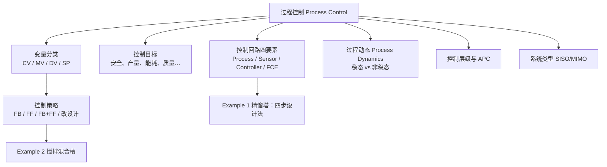
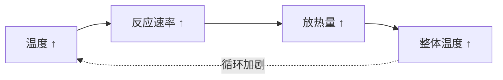
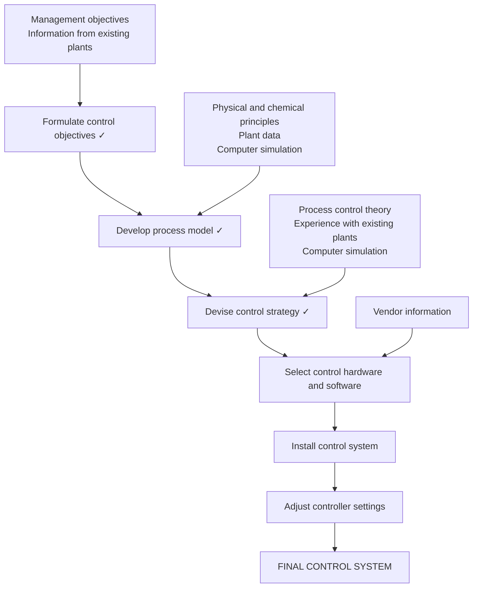

# 过程控制导论 / Topic 1: Introduction to Process Control

> [!NOTE]
> **本节定位**
> - **在课程中的位置**: 第 1 周, L01（Topic 1）
> - **前置知识**: 物料衡算、能量衡算（稳态）
> - **本节核心**: 过程控制 = 测量 → 比较 → 调整的闭环；学会在流程图上找出传感器、控制器、最终控制元件，并区分 CV / MV / DV 和 FB / FF 两大策略。
> - **后续联系**: 动态模型与 Laplace 变换（[L02_laplace_transform_and_transfer_function](L02_laplace_transform_and_transfer_function.md)）、一阶/二阶动态响应（[L03_first_second_order_dynamic_response](L03_first_second_order_dynamic_response.md)）

---

## 知识结构

---

## 知识块 1 — 课程信息

| 项目 | 内容 |
|---|---|
| 讲师 | 讲师 |
| 讲课/辅导 | Week 1–10：周一 9 am–12 pm，周二 1 pm–4 pm |
| 实验 Practical | Week 11–14：周一 9 am–12 pm，周二 1 pm–4 pm |

**课程学习成果（CLOs）**

| CLO | 内容 |
|---|---|
| CLO1 | Develop mathematical and transfer function models for dynamic processes |
| CLO2 | Design process control systems for efficient and sustainable chemical process operation |
| CLO3 | Apply knowledge of process dynamics, and controller settings computing to tune and optimize PID control systems |
| CLO4 | Conduct laboratory investigation on online controller tuning to evaluate process control response |

**考核**

| 项目 | 占比 |
|---|---|
| Assignment | 15 % |
| Test | 20 % |
| Lab Report | 15 % |
| Final Exam | 50 % |

**参考书**
- 必读：Romagnoli & Palazoglu (2020) *Introduction to Process Control*, CRC；Rengaswamy, Srinivasan & Bhatt (2020) *Process Control Fundamentals*, CRC；**Seborg, Edgar, Mellichamp & Doyle (2016) *Process Dynamics and Control*, 4th ed., Wiley**（课件公式编号大多出自此书）。
- 延伸：King (2010) *Process Control: A Practical Approach*；Cook & Munro (1982) *Design of Modern Control Systems*；Shinskey (1996) *Process Control Systems*, 4th ed.；Smith & Corripio (2006) *Principles and Practice of Automatic Process Control*。

**课程大纲（9 个 Topic）**

| Topic | 内容 |
|---|---|
| 1 Introduction | Introduction to process control；Theoretical model of chemical processes |
| 2 Dynamic behavior | Laplace transform；Transfer function；First/second order models；Dynamic response of more complicated processes |
| 3 Dynamic behavior | Development of empirical model |
| 4 FB & FF control | Control strategies at the process unit level；Dynamic behavior and stability of closed-loop system |
| 5 FB & FF control | Block diagram；Closed-loop transfer function and response；Stability of closed loop |
| 6 FB & FF control | PID controller design, tuning and troubleshooting；Performance criteria for closed-loop；Direct synthesis method |
| 7 FB & FF control | Controller tuning relations；Online controller tuning；IMC method |
| 8 FB & FF control | Feedforward control；Cascade control；Ratio control |
| 9 FB & FF control | Control system instrumentation (CH9) |

---

## 知识块 2 — 什么是过程、控制、过程控制

**Process（过程）**：用化学和物理操作把原料（feed）转化成产品的过程；实际使用中，"process" 也常指加工操作和设备本身。课件对 "Control" 和 "Process Control" 只列了词条、留给课堂讲解。

> [!TIP]
> **延伸（非 PPT 内容）**
> **Control（控制）**：让某个变量保持在期望值附近，或按期望方式变化。**Process control（过程控制）**：自动地调整过程的某些输入，使关键输出变量在扰动存在时仍维持在设定值（set point）。

### 淋浴类比：你每天都在做过程控制

洗澡时水突然变冷，你会调冷/热水龙头，直到水温回到你想要的值——**这就是过程控制**。课件把这个类比和化工过程一一对应：

| 淋浴 Shower | 化工过程 Chemical process |
|---|---|
| 想要的水温 Desired temperature | **设定值 Set Point (SP)** |
| 实际水温 Actual temperature | **过程变量 Process Variable (PV)** |
| 拧水龙头 Adjust the tap | **操纵变量 Manipulated Variable (MV)** |
| 你的手/身体 Your hand / body | **测量 / 传感器 Measurement / Sensor** |
| 你自己 You | **控制器 Controller** |

*（此处为课件截图，未收录）*
> F1 驾驶类比：眼睛 = 传感器（Sensor），大脑 = 控制器（Controller），方向盘 = 最终控制元件（Final control element）。

---

## 知识块 3 — 控制回路的四个组成部分

任何一个反馈控制回路都由四部分组成（课件红色编号 1–4）：

1. **Process（过程）**：被控制的对象，例如换热器、反应器。
2. **Measurement Sensor / Transmitter（测量元件 / 变送器）**：测出被控变量并把信号送出去。
3. **Controller（控制器）**：把测量值和设定值比较，算出该怎么调。
4. **Final Control Element（最终控制元件，FCE）**：真正改变过程输入的执行机构，化工厂里最常见的是**控制阀**。

*（此处为课件截图，未收录）*
> 标准反馈控制框图（Control Block Diagram）。信号流：Set Point 与 feedback signal 在比较器相减得到 **controller error** → Controller 输出 **controller output** → FCE 改变 **manipulated process variable** → Process（同时受 **Disturbance** 影响）→ 输出 **measured process variable** → Sensor/Transmitter 送回 **feedback signal**（进入比较器的"−"端）。右侧是气动薄膜调节阀实物照片。

### 实例 1：换热器出口温度控制

*（此处为课件截图，未收录）*
> 工艺流体流过换热器被蒸汽加热。出口管线上的 **TT（温度变送器）** 是 Sensor；它把温度送到 **Controller**；Controller 用信号线去调蒸汽管线上的 **控制阀**（Final control element），改变蒸汽量从而改变出口温度。

### 实例 2：家用暖气温控（Thermostatically Operated Home Heating System）

*（此处为课件截图，未收录）*
> set point 送入 TC（thermostat controller）；室内 TT 把温度送回 TC；TC 发出 control signal 调节燃料管线上的 valve；燃料进 furnace 加热房间；房屋向外散热是扰动 heat loss (disturbance)。

| 角色 | 本例中是什么 |
|---|---|
| Sensor | Temperature transmitter（TT） |
| Controller | Thermostat（TC） |
| Final control element | Control valve（燃料阀） |

（课件右侧这三行文字 MinerU 漏抽，已按页面补全。）

---

## 知识块 4 — 为什么需要控制：控制目标与过程安全

**过程控制的目标（Process control objectives）**
1. 提高产量（product throughput）
2. 提高高附加值产品的收率（yield）
3. 降低能耗
4. 减少污染
5. 减少不合格品（off-spec product）
6. 提高安全性
7. 延长设备寿命
8. 改善可操作性（operability）
9. 减少操作人力

**小的温度偏差可能演变成重大安全事故。** 放热反应存在一条正反馈链：

*（此处为课件截图，未收录）*
这就是**热失控（thermal runaway）**。所以好的工程设计要把 **控制（control）、报警（alarms）、联锁（interlocks）和紧急停车（emergency shutdown, ESD）** 结合起来。

---

## 知识块 5 — 控制系统设计需要的能力 + Example 1 精馏塔

课件列出设计控制系统所需的五项技能：
1. **Identify** 识别传感器位置
2. **Identify** 识别最终控制元件的类型和位置
3. **Design** 设计控制器
4. **Draw** 画出控制回路
5. **Evaluate** 评估控制性能

Example 1 把 3、4 合并，按四步走。

### Example 1：精馏塔控制设计

**第 1 步：识别传感器位置**

*（此处为课件截图，未收录）*
> 二元精馏塔：Feed 从塔中部进入；塔顶蒸汽（压力 P）进冷凝器（热负荷 $Q_D$，用 Coolant 冷却），冷凝液进回流罐（液位 $h_D$），分成回流 Reflux R 和馏出液 Distillate D（组成 $x_D$）；塔釜（液位 $h_B$）经再沸器（热负荷 $Q_B$，Heating medium 加热），塔底采出 Bottoms B（组成 $x_B$）。

图例：**AT** = analyzer/transmitter（组成分析变送器），**LT** = level transmitter（液位变送器），**PT** = pressure transmitter（压力变送器）。

| 传感器 | 位置 | 测量什么 |
|---|---|---|
| PT | 塔顶蒸汽管线 | 塔压 P |
| LT | 回流罐 | 回流罐液位 $h_D$ |
| AT | 馏出液管线 | 馏出液组成 $x_D$ |
| LT | 塔釜 | 塔釜液位 $h_B$ |
| AT | 塔底采出管线 | 塔底组成 $x_B$ |

**第 2 步：识别最终控制元件**

*（此处为课件截图，未收录）*
> 黄框 = 5 个变送器；红圈 = 5 个控制阀。

5 个控制阀分别在：Coolant（冷却水）、Reflux（回流）、Distillate（馏出液）、Heating medium（再沸器加热介质）、Bottoms（塔底采出）。

**第 3 步：设计控制器并画控制回路**

*（此处为课件截图，未收录）*
> 新增一个 **AC（analyzer controller，组成控制器）**：馏出液上的 AT 测 $x_D$ → 信号送 AC → AC 调节 **回流阀**。即"测馏出液组成、调回流量"的反馈组成控制回路。

课件图题写的是复数 "Control Loops"，但图上只画了这一条回路。**第 4 步 Evaluate process control performance** 课件没有给出内容。

> [!TIP]
> **延伸（非 PPT 内容）**
> 为什么调回流能控制 $x_D$？回流比增大 → 塔内分离更彻底 → 馏出液更纯（轻组分 $x_D$ 升高）。其余变送器在完整方案里通常各配一个回路，例如 PT → 调冷却水、回流罐 LT → 调馏出液阀、塔釜 LT → 调塔底采出阀、塔底 AT → 调再沸器加热介质。

---

## 知识块 6 — 过程动态：稳态与非稳态

**Process dynamics（过程动态）** 指的是**非稳态（unsteady-state）或瞬态（transient）**行为。

- **稳态（steady state）**：变量不随时间变化。但"在多大时间尺度上不变"？实际测量总有噪声，所以稳态是相对的。
- 化工课程大多讲稳态或平衡问题，例如物料/能量衡算、热力学。
- **连续过程**里的瞬态例子：
  1. 开车与停车（start up & shutdown）
  2. 产品牌号切换（grade changes）
  3. 重大扰动，例如暴风雨天气下的炼厂
  4. 设备或仪表故障，例如泵故障
- **间歇过程（batch process）**本身就是非稳态操作。例如间歇反应器：组成随时间变化，而温度等其他变量可以保持恒定。

---

## 知识块 7 — 工业规模：多少变量要控制

1. **大型连续过程**（炼油厂、乙烯厂、纸浆厂）
   - 通常测量 **1000–5000 个过程变量**，其中大多数也被控制。
   - 典型变量：流量、温度 T、压力 P、液位、组成。
   - 采样频率：过程变量几秒到几分钟一次；质量变量每 8 小时一班、每天或每周一次。
2. **操纵变量**：过程控制是通过操纵过程变量来实现的，例如进料量、冷却量、产品流量。大型连续装置通常有**几千个**操纵变量。
3. **间歇装置**：多数行业的装置较小，但测量变量仍然很多。
4. **问题**：我们到底怎么控制一个过程？→ 引出 Example 2。

---

## 知识块 8 — 变量分类与控制策略：Example 2 搅拌混合槽

### Example 2：How do we control the process

*（此处为课件截图，未收录）*
> 搅拌混合槽（Stirred tank blending system）：物流 1 是 A、B 混合物（$x_1, w_1$）；物流 2 是纯 A（$x_2 = 1, w_2$），管线上有控制阀；槽内液位 h；出口物流 $x, w$。

**符号**：$w_1, w_2, w$ 为质量流量；$x_1, x_2, x$ 为组分 A 的质量分数。

**Step 1：假设**
1. $w_1$ 恒定
2. $x_2$ = 常数 = 1（物流 2 是纯 A）
3. 槽内完全混合（perfect mixing）

**Step 2：控制目标**：在 $x_1(t)$ 波动的情况下，保持出口组成 $x$ 在期望值（**set point**）$x_{sp}$。为此可以调节流量 $w_2$。

| 术语 | 本例 | 说明 |
|---|---|---|
| **Controlled variable 被控变量 CV**（output variable） | $x$ | 我们要维持的目标 |
| **Manipulated variable 操纵变量 MV**（input variable） | $w_2$ | 我们能调的手段 |
| **Disturbance variable 扰动变量 DV**（load variable） | $x_1$ | 我们控制不了、会带来波动的输入 |

**设计问题**：要使 $\bar{x} = x_{sp}$，需要多大的 $\bar{w}_2$？（上划线表示名义稳态设计值。）

**Step 3：稳态衡算**

总物料衡算：
$$0 = \bar w_1 + \bar w_2 - \bar w \tag{1-1}$$

组分 A 衡算：
$$\bar w_1 \bar x_1 + \bar w_2 \bar x_2 - \bar w \bar x = 0 \tag{1-2}$$

把 (1-1) 得到的 $\bar w = \bar w_1 + \bar w_2$、以及 $\bar x_2 = 1$、$\bar x = x_{SP}$ 代入 (1-2)：

$$\bar w_1 \bar x_1 + \bar w_2 - (\bar w_1 + \bar w_2)x_{SP} = 0 \;\Rightarrow\; \bar w_2(1 - x_{SP}) = \bar w_1(x_{SP} - \bar x_1)$$

$$\boxed{\bar w_2 = \bar w_1\,\frac{x_{SP} - \bar x_1}{1 - x_{SP}}} \tag{1-3}$$

**解读**：(1-3) 是混合系统的**设计方程**。只要假设成立，这个 $\bar w_2$ 就能让 $\bar x = x_{SP}$。

> [!WARNING]
> **讲义勘误**
> 课件原句 "At the design conditions substitute Eq. 1-2, and, then solve Eq. 1-2 for :" 有两处问题：应为"把 **Eq. 1-1**（以及 $\bar x_2 = 1$、$\bar x = x_{SP}$）代入 Eq. 1-2"；"for :" 后面漏了要求解的变量 $\bar w_2$。另外上一页 "nomimal" 是 nominal 的拼写错误。

**控制问题**：如果条件变了怎么办？假设进口组成 $x_1$ 随时间变化。例如 $x_1 > \bar x_1$ 而 $w_2 = \bar w_2$ 不变，则 $x > x_{SP}$。怎么保证 $x$ 留在设定值附近？

### 四种可能的控制方法

**Method 1：测 $x$，调 $w_2$**

直觉：$x$ 太高就减小 $w_2$（少加纯 A）。可以手动也可以自动。**比例反馈控制律（proportional feedback control law）**：

$$w_2(t) = \bar w_2 + K_c\left[x_{SP} - x(t)\right] \tag{1-4}$$

- $K_c$ 叫**控制器增益（controller gain）**。
- $w_2(t)$、$x(t)$ 是随时间变化的变量。
- 流量的变化量 $w_2(t) - \bar w_2$ 与偏差 $x_{SP} - x(t)$ 成正比。

*（此处为课件截图，未收录）*
> Method 1：出口管线上装 **AT（组成分析变送器）** 测 $x$，信号（虚线 = 电信号）送 **AC（组成控制器）**，AC 调物流 2 上的控制阀。**测的是被控变量本身 → 反馈控制（Feedback control, FB）**。

> [!TIP]
> **延伸（非 PPT 内容）**
> $K_c$ 应取正值：因为加入的是纯 A（$x_2 = 1 > x_{SP}$），$x$ 偏高（$x_{SP} - x < 0$）时 $w_2$ 应减小，(1-4) 中 $K_c > 0$ 正好给出 $w_2 < \bar w_2$。

**Method 2：测 $x_1$，调 $w_2$**

若 $x_1 > \bar x_1$，就减小 $w_2$，使 $w_2 < \bar w_2$。一种做法：把设计方程 (1-3) 里的 $\bar x_1$ 换成 $x_1(t)$、$\bar w_2$ 换成 $w_2(t)$，得到控制律：

$$w_2(t) = \bar w_1\,\frac{x_{SP} - x_1(t)}{1 - x_{SP}} \tag{1-5}$$

*（此处为课件截图，未收录）*
> Method 2：AT 装在**进料物流 1** 上测扰动 $x_1$，AC 据此调 $w_2$；出口 $x$ 不测。**在扰动影响出口之前就提前补偿 → 前馈控制（Feedforward control, FF）**。

但 (1-3) 只在稳态成立，所以 (1-5) 在瞬态下效果如何并不清楚。

**Method 3：同时测 $x_1$ 和 $x$，调 $w_2$** —— Method 1 与 Method 2 的组合（FB + FF）。

**Method 4：用更大的槽** —— 槽容量（capacitance）越大，$x_1$ 的波动越容易被"抹平"。代价是投资（capital cost）增加。课件留了开放问题：作为工程师，你会选这个方法吗？

**控制策略汇总表**

| Method | 被控变量 CV | 操纵变量 MV | 扰动变量 DV | 控制策略 |
|---|---|---|---|---|
| 1 | **$x$**（测） | $w_2$ | $x_1$ | FB |
| 2 | $x$ | $w_2$ | **$x_1$**（测） | FF |
| 3 | **$x$**（测） | $w_2$ | **$x_1$**（测） | FB & FF |
| 4 | N/A | N/A | N/A | 改设计：加大槽容 |

> **判断 FB 还是 FF 的关键问题：你的传感器测的是哪个变量？** 测 CV → 反馈；测 DV → 前馈。

| 对比维度 | 反馈控制 Feedback (FB) | 前馈控制 Feedforward (FF) |
|---|---|---|
| 测什么 | 被控变量 CV（出口 $x$） | 扰动变量 DV（进口 $x_1$） |
| 何时动作 | 偏差已经出现之后 | 扰动影响输出之前 |
| 需要过程模型吗 | 不严格需要 | 需要（本例用稳态设计方程） |
| 对未测扰动 | 能纠正 | 无能为力 |

---

## 知识块 9 — 控制系统的类型：SISO 与 MIMO

1. **SISO** – Single Input Single Output（单输入单输出）
2. **MISO** – Multiple Input Single Output
3. **SIMO** – Single Input Multiple Output
4. **MIMO** – Multiple Input Multiple Output（多输入多输出）

*（此处为课件截图，未收录）*
> 一个过程框：左侧进入多个操纵变量（MV, inputs），上方进入多个扰动（disturbances, inputs），右侧输出多个被控变量（CV, outputs）——这就是 MIMO 过程。

---

## 知识块 10 — 过程控制的层级与先进控制

*（此处为课件截图，未收录）*
| 层级 | 活动 | 时间尺度 | 归属 |
|---|---|---|---|
| 5 | Planning and Scheduling 计划调度 | 天–月 | — |
| 4 | Real-Time Optimization 实时优化 | 小时–天 | Advanced Process Control（APC） |
| 3b | Multivariable and Constraint Control 多变量与约束控制 | 分钟–小时 | APC |
| 3a | Regulatory Control 常规调节控制 | 秒–分钟 | **Basic Process Control System（BPCS，本课程 CME329）** |
| 2 | Safety, Environment and Equipment Protection 安全/环保/设备保护 | < 1 秒 | BPCS |
| 1 | Measurement and Actuation 测量与执行 | < 1 秒 | BPCS |
| — | Process | — | — |

相邻层之间信息双向流动。**本课程只讲 BPCS（1、2、3a 层）**。

### 先进控制的经济效益

*（此处为课件截图，未收录）*
*（此处为课件截图，未收录）*
> Figure 1.5：产品指标（% 乙烷）随时间的波动。(a) 改进控制前：波动大，为了不超过 Limit，平均值 $A_1$ 只能离 Limit 远一些。(b) 改进控制后：波动变小，平均值 $A_2$ 可以推到很靠近 Limit 的位置（$A_2 > A_1$）。

**解读**：先"压窄"波动，再把操作点"推向"约束边界（squeeze and shift），从而多赚钱（例如允许含更多乙烷就能少花分离成本）。

---

## 知识块 11 — 控制系统开发的主要步骤

*（此处为课件截图，未收录）*
主线（椭圆 = 工程活动 engineering activity；矩形 = 信息来源 information base）：

课件用红勾标出 **CME329 覆盖前三步**：确定控制目标、建立过程模型、设计控制策略。

---

## 知识块 12 — Example 3：常见错误

**对过程或设备理解有误，控制方案就会失败。**

*（此处为课件截图，未收录）*
> 错误方案：工艺流体经 HP Steam 换热器加热后进反应器 R-33-01，TIC 却去调**工艺流体管线上的阀**。正确做法：**反应器进料温度必须在热源处控制**——调 HP steam 的流量。

*（此处为课件截图，未收录）*
> 错误方案：把罐里的液态水送进压缩机想得到蒸汽。**压缩机不能压缩液体。**

---

## 知识块 13 — 目标、方法、工具 + 课堂活动

| 比喻 | 控制术语 |
|---|---|
| 最终目标 The final target | 被控变量 Controlled Variable |
| 方法 The method | 操纵变量 Manipulated Variable |
| 工具 The tool | 最终控制元件 Final Control Element |

**Class Activity A：最佳能耗（Optimum energy consumption）**；**Class Activity B：优秀 CGPA**。课堂讨论题：分别找出 CV、MV 和最终控制元件。课件没有给答案。

> [!TIP]
> **延伸（非 PPT 内容）**
> 参考思路（Activity B）：CV = CGPA；MV = 每周有效学习时长/复习节奏；FCE = 你的日程表或学习计划；扰动 = 课程难度、考试安排、其他事务。

---

## 对比与总结

| 对比维度 | Sensor / Transmitter | Controller | Final Control Element |
|---|---|---|---|
| 作用 | 测量 PV 并发出信号 | 比较 SP 与 PV，计算输出 | 改变 MV |
| 常见形式 | TT、PT、LT、FT、AT | TC、PC、LC、FC、AC | 控制阀（最常见）、变频泵 |
| 淋浴类比 | 手/身体 | 你自己 | 水龙头 |

---

## 本节引入的核心概念

- Set Point、Controlled Variable、Manipulated Variable、Disturbance Variable
- Feedback Control、Feedforward Control
- Final Control Element

---

## 我的疑问

> [!NOTE]
> 1. Example 1 精馏塔的第 4 步 "Evaluate process control performance" 用什么指标评估？课件没有展开。
> 2. Method 2 的前馈控制律 (1-5) 只在稳态成立，瞬态下会出现多大偏差？需要动态模型才能回答（后续 Topic 8 前馈控制）。
> 3. 比例控制律 (1-4) 能否让 $x$ 完全回到 $x_{SP}$，还是会留下稳态偏差（offset）？
> 4. 精馏塔有 5 个阀、5 个变送器，配对（哪个测量调哪个阀）的原则是什么？

---

## 个人补充

> [!NOTE]
> **我的理解**
> 
