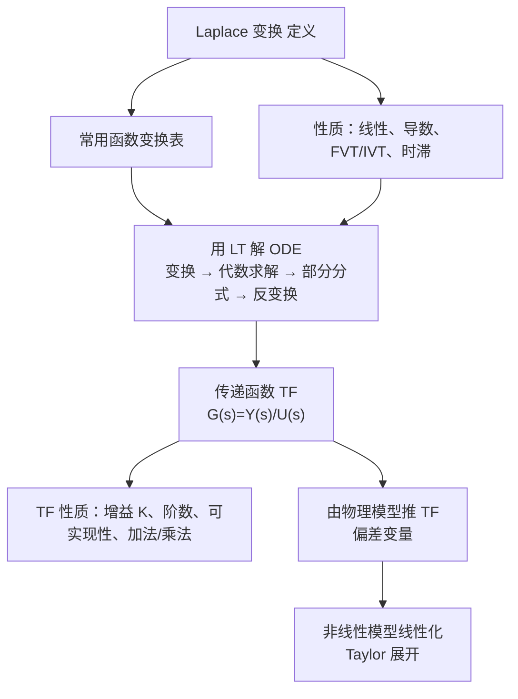
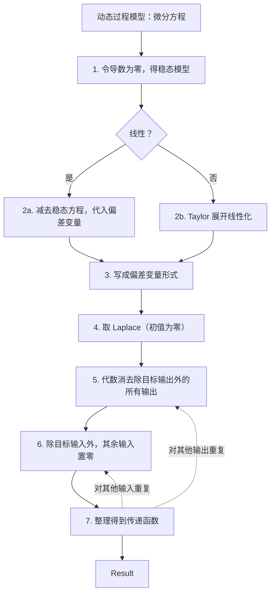

# Laplace 变换与传递函数 / Laplace Transform and Transfer Function

> [!NOTE]
> **本节定位**
> - **在课程中的位置**: 第 2 周, L02（Topic 2 前半：Laplace transform + Transfer function）
> - **前置知识**: [L01_intro_to_process_control](L01_intro_to_process_control.md)、常微分方程、部分分式
> - **本节核心**: 用 Laplace 变换把线性 ODE 变成代数方程；用偏差变量消掉初值；得到传递函数 $G(s)=Y(s)/U(s)$；非线性模型先线性化再求传递函数。
> - **后续联系**: 一阶、二阶及更复杂过程的动态响应（[L03_first_second_order_dynamic_response](L03_first_second_order_dynamic_response.md)）、框图与闭环传递函数（Topic 5）

---

## 知识结构

---

## 知识块 1 — 什么是 Laplace 变换

Laplace 变换（Laplace Transform, LT）是动态与控制中的标准方法：

- 它把**微分方程变成代数运算**，也特别方便做框图分析。
- 它是求解**线性**常微分方程的重要解析方法。非线性 ODE 不能直接用，**必须先线性化**。
- 它是很多过程控制核心概念的基础，例如**传递函数、频率响应、控制系统设计、稳定性分析**。

*（此处为课件截图，未收录）*
> $\mathcal{L}\{f(t)\} = F(s)$：$f(t)$ 是系统或信号的**时域**表示；$F(s)$ 是它的"频域"表示。

> [!TIP]
> **延伸（非 PPT 内容）**
> 严格说 $F(s)$ 是 **s 域（复频域）**表示。真正的"频率响应"是令 $s = j\omega$ 之后的 $F(j\omega)$。

### 定义

$$F(s) = \mathcal{L}[f(t)] = \int_0^\infty f(t)\,e^{-st}\,dt \tag{3-1}$$

- $F(s)$ 是 $f(t)$ 的 Laplace 变换；$\mathcal{L}$ 是变换算子；$f(t)$ 是时间函数。
- **注意**：$\mathcal{L}$ 把时域函数 $f(t)$ 变成 s 域函数 $F(s)$。$s$ 是**复变量**：$s = a + bj$，$j = \sqrt{-1}$。

### 反变换与线性

反变换把 s 域函数变回时域：$f(t) = \mathcal{L}^{-1}[F(s)]$。

**重要性质**：$\mathcal{L}$ 和 $\mathcal{L}^{-1}$ 都是**线性算子**：

$$\mathcal{L}[a\,x(t) + b\,y(t)] = a\,X(s) + b\,Y(s) \tag{3-3}$$

$$\mathcal{L}^{-1}[a\,X(s) + b\,Y(s)] = a\,x(t) + b\,y(t)$$

其中 $x(t)$、$y(t)$ 为任意函数，$a$、$b$ 为常数，$X(s) = \mathcal{L}[x(t)]$，$Y(s) = \mathcal{L}[y(t)]$。

---

## 知识块 2 — 常用函数的 Laplace 变换

逐个用定义 (3-1) 推。

**1. 常数** $f(t) = a$：

$$\mathcal{L}(a) = \int_0^\infty a\,e^{-st}dt = -\frac{a}{s}e^{-st}\Big|_0^\infty = 0 - \left(-\frac{a}{s}\right) = \boxed{\frac{a}{s}} \tag{3-4}$$

**2. 单位阶跃函数**（process control 里用得最多）：

$$S(t) = \begin{cases} 0 & t < 0 \\ 1 & t \ge 0 \end{cases} \tag{3-5}$$

阶跃是"常数"的特例，由 (3-4) 得：

$$\mathcal{L}[S(t)] = \frac{1}{s} \tag{3-6}$$

**3. 导数**（最重要，因为要解的 ODE 里全是导数）：

$$\mathcal{L}\left[\frac{df}{dt}\right] = sF(s) - f(0) \tag{3-9}$$

$f(0)$ 是 $t = 0$ 时的初值。高阶导数：

$$\mathcal{L}\left[\frac{d^n f}{dt^n}\right] = s^nF(s) - s^{n-1}f(0) - s^{n-2}f^{(1)}(0) - \cdots - sf^{(n-2)}(0) - f^{(n-1)}(0) \tag{3-14}$$

其中 $n$ 为任意正整数，$f^{(k)}(0) = \left.\dfrac{d^kf}{dt^k}\right|_{t=0}$。

**特例：所有初值为零**。若 $f(0) = f^{(1)}(0) = \cdots = f^{(n-1)}(0) = 0$，则

$$\mathcal{L}\left[\frac{d^n f}{dt^n}\right] = s^n F(s)$$

过程控制里通常假设零初值。**原因**：使用"偏差变量"时，初值就对应名义稳态，偏差为零（见知识块 7）。

> [!WARNING]
> **讲义勘误（Slide 17）**
> 课件特例条件写成 "Suppose $f(0) = f^{(1)}(0) = \dots = f^{(n-1)}(0)$." 漏了 **"= 0"**。少了它推不出 $\mathcal{L}[d^nf/dt^n] = s^nF(s)$。

> [!TIP]
> **延伸（非 PPT 内容）：导数公式的推导**
> 分部积分：$\int_0^\infty f'e^{-st}dt = \left[f e^{-st}\right]_0^\infty + s\int_0^\infty f e^{-st}dt = -f(0) + sF(s)$。

**4. 指数函数** $f(t) = e^{-bt}$（$b > 0$）：

$$\mathcal{L}[e^{-bt}] = \int_0^\infty e^{-(b+s)t}dt = \frac{1}{b+s}\left[-e^{-(b+s)t}\right]_0^\infty = \boxed{\frac{1}{s+b}} \tag{3-16}$$

> [!TIP]
> **延伸（非 PPT 内容）**
> 上面几处取上限 $\infty$ 时 $e^{-st} \to 0$，隐含要求 $\mathrm{Re}(s) > 0$（指数函数要求 $\mathrm{Re}(s+b) > 0$），课件没写这个收敛条件。

**5. 矩形脉冲** 高度 $h$、宽度 $t_w$：

$$f(t) = \begin{cases} 0 & t < 0 \\ h & 0 \le t < t_w \\ 0 & t \ge t_w \end{cases} \tag{3-20}$$

*（此处为课件截图，未收录）*
> Figure 3.1：$0 \le t < t_w$ 时 $f = h$，$t_w$ 处跌回 0。

$$F(s) = \frac{h}{s}\left(1 - e^{-t_w s}\right) \tag{3-22}$$

**解读**：脉冲 = 在 0 时刻上跳 $h$ 的阶跃，减去在 $t_w$ 时刻上跳 $h$ 的阶跃；后者因时滞 $t_w$ 多乘一个 $e^{-t_w s}$。

**6. 冲激函数（Dirac Delta）** $\delta(t)$：把矩形脉冲的宽度 $t_w \to 0$，同时保持面积为 1（即 $h = 1/t_w$）的极限。

$$\mathcal{L}[\delta(t)] = 1$$

### Laplace 变换表（Table 3.1）

*（此处为课件截图，未收录）*
| # | $f(t)$ | $F(s)$ |
|---|---|---|
| 1 | $\delta(t)$（单位冲激） | $1$ |
| 2 | $S(t)$（单位阶跃） | $\dfrac{1}{s}$ |
| 3 | $t$（斜坡） | $\dfrac{1}{s^2}$ |
| 4 | $t^{n-1}$ | $\dfrac{(n-1)!}{s^n}$ |
| 5 | $e^{-bt}$ | $\dfrac{1}{s+b}$ |
| 6 | $\dfrac{1}{\tau}e^{-t/\tau}$ | $\dfrac{1}{\tau s+1}$ |
| 7 | $\dfrac{t^{n-1}e^{-bt}}{(n-1)!}$ $(n>0)$ | $\dfrac{1}{(s+b)^n}$ |
| 8 | $\dfrac{1}{\tau^n(n-1)!}t^{n-1}e^{-t/\tau}$ | $\dfrac{1}{(\tau s+1)^n}$ |
| 9 | $\dfrac{1}{b_1-b_2}\left(e^{-b_2t}-e^{-b_1t}\right)$ | $\dfrac{1}{(s+b_1)(s+b_2)}$ |
| 10 | $\dfrac{1}{\tau_1-\tau_2}\left(e^{-t/\tau_1}-e^{-t/\tau_2}\right)$ | $\dfrac{1}{(\tau_1s+1)(\tau_2s+1)}$ |
| 15 | $\cos\omega t$ | $\dfrac{s}{s^2+\omega^2}$ |
| 16 | $\sin(\omega t+\phi)$ | $\dfrac{\omega\cos\phi+s\sin\phi}{s^2+\omega^2}$ |
| 17 | $e^{-bt}\sin\omega t$ | $\dfrac{\omega}{(s+b)^2+\omega^2}$ |
| 18 | $e^{-bt}\cos\omega t$ | $\dfrac{s+b}{(s+b)^2+\omega^2}$ |
| 19 | $\dfrac{1}{\tau\sqrt{1-\zeta^2}}e^{-\zeta t/\tau}\sin\left(\sqrt{1-\zeta^2}\,t/\tau\right)$ $(0\le\lvert\zeta\rvert<1)$ | $\dfrac{1}{\tau^2s^2+2\zeta\tau s+1}$ |
| 20 | $1+\dfrac{1}{\tau_2-\tau_1}\left(\tau_1e^{-t/\tau_1}-\tau_2e^{-t/\tau_2}\right)$ $(\tau_1\ne\tau_2)$ | $\dfrac{1}{s(\tau_1s+1)(\tau_2s+1)}$ |
| 21 | $1-\dfrac{1}{\sqrt{1-\zeta^2}}e^{-\zeta t/\tau}\sin\left[\sqrt{1-\zeta^2}\,t/\tau+\psi\right]$，$\psi=\tan^{-1}\dfrac{\sqrt{1-\zeta^2}}{\zeta}$ | $\dfrac{1}{s(\tau^2s^2+2\zeta\tau s+1)}$ |
| 22 | $1-e^{-\zeta t/\tau}\left[\cos\left(\sqrt{1-\zeta^2}\,t/\tau\right)+\dfrac{\zeta}{\sqrt{1-\zeta^2}}\sin\left(\sqrt{1-\zeta^2}\,t/\tau\right)\right]$ | $\dfrac{1}{s(\tau^2s^2+2\zeta\tau s+1)}$ |
| 23 | $1+\dfrac{\tau_3-\tau_1}{\tau_1-\tau_2}e^{-t/\tau_1}+\dfrac{\tau_3-\tau_2}{\tau_2-\tau_1}e^{-t/\tau_2}$ $(\tau_1\ne\tau_2)$ | $\dfrac{\tau_3s+1}{s(\tau_1s+1)(\tau_2s+1)}$ |
| 24 | $\dfrac{df}{dt}$ | $sF(s)-f(0)$ ⭐ |
| 25 | $\dfrac{d^nf}{dt^n}$ | $s^nF(s)-s^{n-1}f(0)-\cdots-f^{(n-1)}(0)$ |
| 26 | $f(t-t_0)S(t-t_0)$ | $e^{-t_0s}F(s)$ |

注：$f(t)$ 和 $F(s)$ 只对 $t \ge 0$ 定义。课件跳过了第 11–14 行。第 24 行（导数）是课件红圈标出的重点。

*（此处为课件截图，未收录）*
> [!WARNING]
> **讲义勘误**
> 第 6 行在教材截图里像 $e^{-l/\tau}$，应为 $e^{-t/\tau}$。Slide 19 的 "transtorm ot" 应为 "transform of"。

---

## 知识块 3 — 用 Laplace 变换解 ODE

**步骤**
1. 对 ODE 两边取 $\mathcal{L}$。
2. 在 s 域整理代数方程，解出输出的变换，例如 $Y(s)$。
3. 做部分分式展开（PFE）。
4. 用 $\mathcal{L}^{-1}$（查表）从 $Y(s)$ 得到 $y(t)$。

### Example 1：解 $5\dfrac{dy}{dt} + 4y = 2$，$y(0) = 1$ (3-26)

课件只给了题干。页脚页码从 26 跳到 31，解答页被删掉了。以下解答为**课本补充**，已用 Python 验算。

1. 取 Laplace：$5[sY(s) - 1] + 4Y(s) = \dfrac{2}{s}$
2. 解出 $Y(s)$：$Y(s) = \dfrac{5s + 2}{s(5s + 4)}$
3. 部分分式：$Y(s) = \dfrac{0.5}{s} + \dfrac{0.5}{s + 0.8}$
4. 反变换：

$$\boxed{y(t) = 0.5 + 0.5\,e^{-0.8t}}$$

**校核**：$y(0) = 1$ ✓；$t \to \infty$ 时 $y \to 2/4 = 0.5$ ✓（令导数为零得稳态）。

### 部分分式展开（Partial Fraction Expansion, PFE）

**基本思路**：把复杂的 $Y(s)$ 拆成几个简单项，每一项都能在 Laplace 表里查到，再对两边取 $\mathcal{L}^{-1}$。

**一般形式**：

$$Y(s) = \frac{N(s)}{D(s)} = \frac{N(s)}{\prod_{i=1}^{n}(s + b_i)} \tag{3-46a}$$

当 $D(s)$ 的根 $s = -b_i$ 都是**互不相同的实数**（没有重根）时：

$$Y(s) = \sum_{i=1}^{n}\frac{\alpha_i}{s + b_i} \tag{3-46b}$$

$D(s)$ 叫**特征多项式（characteristic polynomial）**。

课件页底另写了 $b_i = 3 \pm 4j$ 和 $b_1 = b_2 = -3$，没有文字说明。推测是 (3-46b) **不适用**的两种反例：复根和重根。

> [!WARNING]
> **讲义勘误**
> 课件中连乘号印成小写 $\pi$，应为 $\prod$。

### PFE 示例：$Y(s) = \dfrac{s + 5}{(s + 1)(s + 4)}$ (3-41)

设 $\dfrac{s+5}{(s+1)(s+4)} = \dfrac{\alpha_1}{s+1} + \dfrac{\alpha_2}{s+4}$ (3-42)，求 $\alpha_1, \alpha_2$。三种方法：

**方法 1：系数比较法（Coefficient method）**。两边乘 $(s+1)(s+4)$：

$$s + 5 = \alpha_1(s + 4) + \alpha_2(s + 1) = (\alpha_1 + \alpha_2)s + 4\alpha_1 + \alpha_2$$

比较同次幂系数：$s^1$：$\alpha_1 + \alpha_2 = 1$；$s^0$：$4\alpha_1 + \alpha_2 = 5$。联立得 $\alpha_1 = \dfrac{4}{3}$，$\alpha_2 = -\dfrac{1}{3}$。

**方法 2：代特殊值法**。(3-42) 对所有 $s$ 都成立，取两个 $s$ 值：

- $s = -5$：$0 = -\dfrac{1}{4}\alpha_1 - \alpha_2$
- $s = -3$：$-\dfrac{2}{2} = -\dfrac{1}{2}\alpha_1 + \alpha_2$

联立得 $\alpha_1 = \dfrac{4}{3}$，$\alpha_2 = -\dfrac{1}{3}$。

**方法 3：Heaviside 展开（最快）**。两边乘某个分母因子，再令 $s$ 等于它的根：

$$\alpha_1 = \left.\frac{s+5}{s+4}\right|_{s=-1} = \frac{4}{3}, \qquad \alpha_2 = \left.\frac{s+5}{s+1}\right|_{s=-4} = -\frac{1}{3}$$

所以 $y(t) = \dfrac{4}{3}e^{-t} - \dfrac{1}{3}e^{-4t}$（Python 验算 ✓）。

### Example 2：三阶 ODE

ODE $\dddot y + 6\ddot y + 11\dot y + 6y = 1$，零初值，得

$$Y(s) = \frac{1}{s(s^3 + 6s^2 + 11s + 6)} \tag{3-40}$$

分母因式分解：

$$s(s^3 + 6s^2 + 11s + 6) = s(s+1)(s+2)(s+3) \tag{3-50}$$

**注意**：一般情况下求根需要数值方法。PFE：

$$Y(s) = \frac{\alpha_1}{s} + \frac{\alpha_2}{s+1} + \frac{\alpha_3}{s+2} + \frac{\alpha_4}{s+3} \tag{3-51}$$

用 Heaviside 法，例如求 $\alpha_1$：两边乘 $s$ 再令 $s = 0$，$\alpha_1 = \dfrac{1}{1 \cdot 2 \cdot 3} = \dfrac{1}{6}$。同理：

$$\alpha_1 = \frac{1}{6},\quad \alpha_2 = -\frac{1}{2},\quad \alpha_3 = \frac{1}{2},\quad \alpha_4 = -\frac{1}{6}$$

$$Y(s) = \frac{1/6}{s} - \frac{1/2}{s+1} + \frac{1/2}{s+2} - \frac{1/6}{s+3}$$

查表 3.1 逐项反变换：

$$\boxed{y(t) = \frac{1}{6} - \frac{1}{2}e^{-t} + \frac{1}{2}e^{-2t} - \frac{1}{6}e^{-3t}} \tag{3-52}$$

**校核**：$y(0) = 1/6 - 1/2 + 1/2 - 1/6 = 0$ ✓（零初值）；$y(\infty) = 1/6$ ✓（稳态 $6y = 1$）。Python 验算 ✓。

> [!WARNING]
> **讲义勘误（Example 2）**
> - Slide 34 的 ODE 印成 "$\ddot y + + 6\ddot y + \dots$"：多了一个 "+"，第一项应为**三阶导** $\dddot y$（与 $s^3$ 对应）。
> - Slide 35 中 $Y(s)$ 和 $\mathcal{L}^{-1}$ 两行的最后一项写成 "$+\dfrac{1/6}{s+3}$"，应为 **"$-\dfrac{1/6}{s+3}$"**（因为 $\alpha_4 = -1/6$）。最终 (3-52) 的 $-\frac16 e^{-3t}$ 是对的。
> - 提示句 "find $\alpha$" 缺下标，应为 $\alpha_1$。

---

## 知识块 4 — Laplace 变换的重要性质：FVT、IVT、时滞

### 1. 终值定理（Final Value Theorem, FVT）

用于求闭环系统的稳态值（前提是稳态值存在）：

$$\lim_{t\to\infty} y(t) = \lim_{s\to 0}\left[sY(s)\right]$$

条件：对所有 $\mathrm{Re}(s) \ge 0$，$sY(s)$ 的极限存在（有限）。$\mathrm{Re}(s)$ 是复变量 $s$ 的实部。

### 2. 初值定理（Initial Value Theorem, IVT）

$$\lim_{t\to 0} y(t) = \lim_{s\to\infty}\left[sY(s)\right]$$

> [!WARNING]
> **讲义勘误（Slide 37）**
> IVT 页的说明文字是从 FVT 页原样复制的。IVT 用来求**初值** $y(0^+)$，不是 "steady-state value of a closed loop system"。"for all $\mathrm{Re}(s) \ge 0$" 也是 FVT 的适用条件，IVT 只要求极限存在。

### Example 3（a）：对 Example 1 的结果用 IVT 和 FVT

$Y(s) = \dfrac{5s + 2}{s(5s + 4)}$，所以 $sY(s) = \dfrac{5s + 2}{5s + 4}$。

$$y(0) = \lim_{s\to\infty}\frac{5s+2}{5s+4} = 1 \tag{3-83a}$$

$$y(\infty) = \lim_{s\to 0}\frac{5s+2}{5s+4} = 0.5 \tag{3-83b}$$

初值 1 与给定初始条件一致，终值 0.5 与时域解一致。**两个定理都很适合用来检查 Laplace 求解有没有算错。**

### Example 3（b）：三阶过程的稳态

过程：$\dfrac{d^3y}{dt^3} + 6\dfrac{d^2y}{dt^2} + 11\dfrac{dy}{dt} + 6y = 4u$ (3-84)，零初值，$u$ 阶跃 2 个单位。证明时域稳态结果与 FVT 一致。

**方法一：时域稳态**。导数全部为零，代入 $u = 2$：

$$6y = 8 \;\Rightarrow\; y = 4/3 \tag{3-85}$$

**方法二：FVT**。取 Laplace（$U(s) = 2/s$）：

$$(s^3 + 6s^2 + 11s + 6)Y(s) = 8/s \tag{3-86}$$

$$Y(s) = \frac{8}{s^4 + 6s^3 + 11s^2 + 6s} \tag{3-87}$$

FVT 的好处是**不用解出 $y(t)$**：

$$\lim_{s\to 0}sY(s) = \lim_{s\to 0}\frac{8}{s^3 + 6s^2 + 11s + 6} = \frac{8}{6} = \frac{4}{3} \tag{3-88}$$

两法一致 ✓。特征根 $-1, -2, -3$ 都在左半平面，FVT 适用。（教材原文 "$dy^2/dt^2$" 应为 $d^2y/dt^2$。）

### 3. 时滞（Time Delay）

时滞来自流体在管道中流动、做分析需要时间（例如气相色谱）等。延迟后的信号写作 $y(t - \theta)$，$\theta$ 为时滞：

$$\mathcal{L}[y(t-\theta)] = e^{-\theta s}\,Y(s)$$

*（此处为课件截图，未收录）*
*（此处为课件截图，未收录）*
> Figure 3.3：(a) 原函数 $f(t)$；(b) 有时滞 $t_0$ 的函数 $f_d(t)$：在 $0$ 到 $t_0$ 之间为 0，之后形状与 (a) 完全相同，整体右移 $t_0$。

> [!TIP]
> **延伸（非 PPT 内容）**
> 严格写法是 $\mathcal{L}[y(t-\theta)S(t-\theta)] = e^{-\theta s}Y(s)$，即 $t < \theta$ 时信号为零（表 3.1 第 26 行）。课件文字用 $\theta$，图用 $t_0$，两者同义。

---

## 知识块 5 — 传递函数（Transfer Function, TF）

- TF 是**线性**动态模型的一种便捷表示。
- 一个 TF 只联系**一个**输入和**一个**输出：$x(t)/X(s) \rightarrow$ system $\rightarrow y(t)/Y(s)$。

| $x$ | $y$ |
|---|---|
| input 输入 | output 输出 |
| forcing function 强制函数 | response 响应 |
| "cause" 原因 | "effect" 结果 |

**定义**：设 $G(s)$ 为输入 $x$ 与输出 $y$ 之间的传递函数，则

$$G(s) = \frac{Y(s)}{X(s)}, \qquad Y(s) = \mathcal{L}[y(t)],\quad X(s) = \mathcal{L}[x(t)]$$

---

## 知识块 6 — 传递函数模型的性质

### 1. 稳态增益（Steady-State Gain）K

已知输入 $u$、输出 $y$ 的两个稳态，就能算稳态增益：

$$K = \frac{\bar y_2 - \bar y_1}{\bar u_2 - \bar u_1} \tag{4-38}$$

线性系统的 $K$ 是常数；非线性系统的 $K$ 随操作点 $(\bar u, \bar y)$ 变化。

**从 TF 求 K**（若 TF 有稳态增益）：

$$\boxed{K = \lim_{s\to 0}G(s)} \tag{14}$$

这是终值定理的直接结果。**注意**：有些 TF 没有稳态增益，例如积分过程（见 [L03_first_second_order_dynamic_response](L03_first_second_order_dynamic_response.md)）。

> [!TIP]
> **延伸（非 PPT 内容）：为什么 $K = \lim_{s\to0}G(s)$**
> 输入幅值为 $M$ 的阶跃：$Y(s) = G(s)M/s$。由 FVT，$y(\infty) = \lim_{s\to0} s \cdot G(s)M/s = M\lim_{s\to0}G(s)$，所以 $K = y(\infty)/M = \lim_{s\to0}G(s)$。

### 2. TF 的阶数（Order）

一般 n 阶线性 ODE：

$$a_n\frac{d^ny}{dt^n} + a_{n-1}\frac{d^{n-1}y}{dt^{n-1}} + \cdots + a_1\frac{dy}{dt} + a_0y = b_m\frac{d^mu}{dt^m} + b_{m-1}\frac{d^{m-1}u}{dt^{m-1}} + \cdots + b_1\frac{du}{dt} + b_0u \tag{4-39}$$

零初值下取 $\mathcal{L}$，整理得：

$$G(s) = \frac{Y(s)}{U(s)} = \frac{\sum_{i=0}^{m}b_is^i}{\sum_{i=0}^{n}a_is^i} \tag{4-40}$$

**定义**：TF 的阶数 = **分母多项式的阶数** = ODE 的阶数。

> [!WARNING]
> **讲义勘误（Slide 47）**
> 第二项印成 $\dfrac{dy^{n-1}}{dt^{n-1}}$，应为 $\dfrac{d^{n-1}y}{dt^{n-1}}$；"$+\cdots a_1$" 漏了一个 "+"。

**物理可实现性（Physical Realizability）**：任何物理系统必须 $n \ge m$。否则输入阶跃时，输出里会出现冲激——这不可能发生。

**例**：$a_0 y = b_1\dfrac{du}{dt} + b_0 u$，$u$ 阶跃 (4-41)。这里 $n = 0 < m = 1$。$u$ 阶跃时 $du/dt$ 是冲激 $\delta(t)$，于是 $y$ 里也出现冲激，物理上不可实现。

### 3. 加法性质（Additive Property）

输出同时受两个输入影响，且 $\dfrac{Y(s)}{U_1(s)} = G_1(s)$、$\dfrac{Y(s)}{U_2(s)} = G_2(s)$，则两个输入同时变化时：

$$Y(s) = G_1(s)U_1(s) + G_2(s)U_2(s)$$

*（此处为课件截图，未收录）*
> Figure 4.1 加法传递函数模型的框图：两路并联，在求和点相加。

### 4. 乘法性质（Multiplicative Property）

若 $\dfrac{Y(s)}{U_2(s)} = G_2(s)$ 且 $\dfrac{U_2(s)}{U_3(s)} = G_3(s)$，则 $Y = G_2U_2$，$U_2 = G_3U_3$。代入得

$$Y(s) = G_2(s)G_3(s)U_3(s) \quad\Longrightarrow\quad \frac{Y(s)}{U_3(s)} = G_2(s)G_3(s)$$

按关系式，正确的信号流是：

> [!WARNING]
> **讲义勘误（Slide 50）**
> 课件框图画成 $U_3 \to [G_2] \to [G_3] \to Y$，方块顺序反了。按 $U_2 = G_3U_3$、$Y = G_2U_2$，应先过 $G_3$ 再过 $G_2$。因为乘法可交换，总传函 $G_2G_3$ 不受影响，但中间信号的含义错了。

---

## 知识块 7 — 由物理模型推导传递函数：搅拌加热槽

### Example 1：Stirred Tank Heating System

*（此处为课件截图，未收录）*
> Figure 2.3：恒持液量 $V$ 的搅拌加热槽。进料 $T_i, w_i$；出料 $T, w$；底部加热器热负荷 $Q$。

**Step 1：动态模型**（持液量和流量恒定）：

$$V\rho C\frac{dT}{dt} = wC(T_i - T) + Q \quad \text{(Eq. 1)}$$

**Step 2：初始稳态**：

$$T(0) = \bar T,\quad T_i(0) = \bar T_i,\quad Q(0) = \bar Q \quad \text{(Eq. 2)}$$

$\bar T$ 是 $T$ 的稳态值，其余类推。稳态时：

$$0 = wC(\bar T_i - \bar T) + \bar Q \quad \text{(Eq. 3)}$$

**Step 3：(1) 减 (3)**：

$$V\rho C\frac{dT}{dt} = wC\left[(T_i - \bar T_i) - (T - \bar T)\right] + (Q - \bar Q) \quad \text{(Eq. 4)}$$

**Step 4：引入偏差变量**。$\bar T$ 是常数，所以 $\dfrac{dT}{dt} = \dfrac{d(T - \bar T)}{dt}$ (Eq. 5)。代入 (4)：

$$V\rho C\frac{dT'}{dt} = wC(T_i' - T') + Q' \quad \text{(Eq. 6)}$$

**偏差变量（deviation variables，也叫 perturbation variables）**：

$$T' = T - \bar T,\quad T_i' = T_i - \bar T_i,\quad Q' = Q - \bar Q \quad \text{(Eq. 7)}$$

**Step 5：取 Laplace**：

$$V\rho C\left[sT'(s) - T'(0)\right] = wC\left[T_i'(s) - T'(s)\right] + Q'(s) \quad \text{(Eq. 8)}$$

> [!WARNING]
> **讲义勘误（Slide 54）**
> - 课件 Eq. 8 右端最后一项写成 **"$-Q'(s)$"**，应为 **"$+Q'(s)$"**（Eq. 6 是 $+Q'$，后面的 Eq. 10 用的也是 $+K Q'$）。
> - "substitute into (4-2)" 是教材编号残留，本课件应为 **Eq. 4**。Slide 53 的 "Substract" 应为 "Subtract"。

**Step 6：求初值** $T'(0)$。由定义 $T'(0) = T(0) - \bar T$ (Eq. 9)。因为假设过程初始处于稳态，$T(0) = \bar T$，所以 $T'(0) = 0$。

**这就是偏差变量的好处：初值项变成零，后续分析大大简化。**

**Step 7：整理**：

$$T'(s) = \left(\frac{K}{\tau s + 1}\right)Q'(s) + \left(\frac{1}{\tau s + 1}\right)T_i'(s) \quad \text{(Eq. 10)}$$

$$K = \frac{1}{wC}, \qquad \tau = \frac{V\rho}{w} \quad \text{(Eq. 11)}$$

**$Q'$ 到 $T'$ 的 TF**：令 $T_i$ 保持稳态值，则 $T_i'(t) = 0 \Rightarrow T_i'(s) = 0$：

$$\boxed{\frac{T'(s)}{Q'(s)} = \frac{K}{\tau s + 1}} \quad \text{(Eq. 12)}$$

**$T_i'$ 到 $T'$ 的 TF**：令 $Q$ 保持稳态值，则 $Q'(s) = 0$：

$$\boxed{\frac{T'(s)}{T_i'(s)} = \frac{1}{\tau s + 1}} \quad \text{(Eq. 13)}$$

**几点说明**
1. (12) 和 (13) 分别表示 $Q$ 和 $T_i$ **单独**对 $T$ 的影响。两者**同时**变化怎么办？答案见 (10)：同样的 TF 对同时变化依然成立，效果是**相加**的。线性动态模型（比如 TF）总是这样，因为**叠加原理**成立。
2. 有了 TF 模型，就能求输出对任意输入变化的响应。
3. 用偏差变量消掉 TF 模型里的初值。

**解读**：$\tau = V\rho/w$ = 槽内质量 ÷ 质量流量 = **停留时间**。槽越大、流量越小，温度响应越慢。

### 课堂 Activity：MV 是进料流量时，写出槽温的传递函数

题目：对同一搅拌加热槽，"Write a general transfer function for the temperature of tank. Given the MV is inlet flow rate." 课件答题框留空。

*（此处为课件截图，未收录）*
以下为**参考解（非课件内容）**，已用 sympy 验算。

1. 恒体积，所以 $w = w_i$。能量衡算：$\rho VC\dfrac{dT}{dt} = wC(T_i - T) + Q$。
2. $wT$ 是**两个变量相乘的非线性项**，要在 $(\bar w, \bar T)$ 处线性化：

$$\rho V\frac{dT'}{dt} = (\bar T_i - \bar T)\,w' - \bar w\,T' \quad (T_i, Q\text{ 视为不变})$$

3. 取 Laplace 整理：

$$\frac{T'(s)}{W'(s)} = \frac{K}{\tau s + 1},\qquad K = \frac{\bar T_i - \bar T}{\bar w},\quad \tau = \frac{\rho V}{\bar w}$$

**解读**：加热时 $\bar T > \bar T_i$，所以 $K < 0$：进料加大，槽温下降，符合直觉。

---

## 知识块 8 — 非线性模型的线性化

- 前面讲的都是可以变成 TF 的线性模型。
- 但大多数物理过程和物理模型是**非线性**的。
- 不过在一个小的操作范围内，行为可能近似线性。**结论**：线性近似很有用，尤其是做分析时。
- 线性模型可以用"**线性化（linearization）**"解析地得到：在指定操作点对非线性函数做 **Taylor 级数展开**。

### Method 1：逐步线性化（Stepwise linearization）

非线性动态模型：

$$\frac{dy}{dt} = f(u, y) \tag{4-60}$$

在 $u = \bar u$、$y = \bar y$ 处做 Taylor 展开，保留一阶项：

$$f(u, y) \approx f(\bar u, \bar y) + \left.\frac{\partial f}{\partial u}\right|_{\bar y}u' + \left.\frac{\partial f}{\partial y}\right|_{\bar u}y' \tag{4-61}$$

其中 $u' = u - \bar u$，$y' = y - \bar y$。偏导数在名义操作点 $(\bar u, \bar y)$ 处求值，所以是**常数**。代入 (4-60)：

$$\frac{dy}{dt} = f(\bar u, \bar y) + \left.\frac{\partial f}{\partial u}\right|_{\bar y}u' + \left.\frac{\partial f}{\partial y}\right|_{\bar u}y'$$

(4-60) 的稳态形式是 $0 = f(\bar u, \bar y)$。代入上式，并注意 $\dfrac{dy}{dt} = \dfrac{dy'}{dt}$，得**线性化模型**：

$$\boxed{\frac{dy'}{dt} = \left.\frac{\partial f}{\partial u}\right|_{\bar y}u' + \left.\frac{\partial f}{\partial y}\right|_{\bar u}y'} \tag{4-62}$$

> [!WARNING]
> **讲义勘误（Slide 62）**
> 课件说 "Substitute into (7)"，但本课件没有编号为 (7) 的式子。它指的是 Slide 61 最后那个没编号的式子（教材编号残留）。

### Example 2（Method 2：启发式线性化 Heuristic linearization）：液位储罐

*（此处为课件截图，未收录）*
> 敞口储罐：顶部进料 $q_i$，液位 $h$，底部出口阀流量 $q$。

已知：
- 质量衡算：$A\dfrac{dh}{dt} = q_i - q$ (1)
- 阀门关系：$q = C_v\sqrt{h}$ (2)
- $A$ = 截面积，$C_v$ = 常数

**Step 1：合并 (1)(2)**：

$$A\frac{dh}{dt} = q_i - C_v\sqrt{h} \quad (3)$$

**Step 2：线性化 $\sqrt{h}$**。$\sqrt h$ 在 $\bar h$ 处的一阶 Taylor 展开（导数 $\frac{1}{2\sqrt h} > 0$）：

$$\sqrt{h} \approx \sqrt{\bar h} + \frac{1}{2\sqrt{\bar h}}(h - \bar h) \quad (4)$$

$$\sqrt{h} \approx \sqrt{\bar h} + \frac{1}{R}h' \quad (5) \qquad R = 2\sqrt{\bar h},\; h' = h - \bar h$$

> [!WARNING]
> **讲义勘误（Slides 64–65）：符号错误**
> 课件 Eq. (4)、(5) 写成 "$\sqrt{\bar h}\;\mathbf{-}\;\dfrac{1}{2\sqrt{\bar h}}(h-\bar h)$"，**符号错了**，应为 **"+"**（sympy 验算：$\sqrt h \approx \sqrt{\bar h} + (h-\bar h)/(2\sqrt{\bar h})$）。Eq. (6) 照搬了错误的 (5)；如果真按 (6) 去减 (7)，会得到 $A\,dh'/dt = q_i' + (C_v/R)h'$，与 Eq. (8) 矛盾。**Eq. (8) 本身是对的**，错在中间三步的符号。下面按正确符号写。

**Step 3：代入 (3)**：

$$A\frac{dh}{dt} = q_i - C_v\left(\sqrt{\bar h} + \frac{1}{R}h'\right) \quad (6)$$

**Step 4：(3) 的稳态形式**：

$$0 = \bar q_i - C_v\sqrt{\bar h} \quad (7)$$

**Step 5：(6) 减 (7)**，令 $q_i' = q_i - \bar q_i$，并注意 $\dfrac{dh}{dt} = \dfrac{dh'}{dt}$，得线性化模型：

$$A\frac{dh'}{dt} = q_i' - \frac{C_v}{R}h' \quad (8)$$

**Step 6：取 Laplace**（$h'(0) = 0$）：

$$AsH'(s) + \frac{C_v}{R}H'(s) = Q_i'(s)$$

$$\boxed{G(s) = \frac{H'(s)}{Q_i'(s)} = \frac{1}{As + C_v/R} = \frac{R/C_v}{\dfrac{AR}{C_v}s + 1}}$$

**解读**：一阶 TF，增益 $K = R/C_v = 2\sqrt{\bar h}/C_v$，时间常数 $\tau = AR/C_v = 2A\sqrt{\bar h}/C_v$。液位越高，$K$ 和 $\tau$ 都越大：非线性系统的参数随操作点变化。

**课件留的练习：用 Method 1（Taylor 逐步法）重做并比较。**

> [!TIP]
> **延伸（非 PPT 内容）：Method 1 解法**
> 令 $f(q_i, h) = \dfrac{q_i - C_v\sqrt h}{A}$。$\left.\dfrac{\partial f}{\partial q_i}\right. = \dfrac1A$，$\left.\dfrac{\partial f}{\partial h}\right|_{\bar h} = -\dfrac{C_v}{2A\sqrt{\bar h}}$。代入 (4-62)：$\dfrac{dh'}{dt} = \dfrac{1}{A}q_i' - \dfrac{C_v}{2A\sqrt{\bar h}}h'$，两边乘 $A$ 就是 Eq. (8)。两种方法结果完全一致（sympy 验算 ✓），这也再次说明 Slide 64 的负号是笔误。

### 推导传递函数的通用流程

*（此处为课件截图，未收录）*

### 总结：线性化非线性动态模型的关键步骤

1. 对每个非线性项做 Taylor 展开，保留一阶项。
2. 减去方程的稳态形式。
3. 引入偏差变量。

---

## 对比与总结

| 对比维度 | 逐步线性化 Method 1 | 启发式线性化 Method 2 |
|---|---|---|
| 做法 | 对整个右端 $f(u,y)$ 求偏导 | 只把非线性项（如 $\sqrt h$）单独展开 |
| 优点 | 套公式 (4-62)，不易漏项 | 直观，步骤少 |
| 结果 | 两者完全相同 | 两者完全相同 |

| 对比维度 | FVT | IVT |
|---|---|---|
| 公式 | $\lim_{t\to\infty}y = \lim_{s\to0}sY(s)$ | $\lim_{t\to0}y = \lim_{s\to\infty}sY(s)$ |
| 求什么 | 稳态终值 | 初值 |
| 条件 | $sY(s)$ 在 $\mathrm{Re}(s)\ge0$ 无极点 | 极限存在 |

---

## 本节引入的核心概念

- Laplace Transform、Partial Fraction Expansion
- Final Value Theorem、Initial Value Theorem
- Transfer Function、Steady-State Gain、Deviation Variable
- Linearization

---

## 我的疑问

> [!NOTE]
> 1. 课件跳过了 Table 3.1 第 11–14 行（应包括 $\sin\omega t$ 等），考试会不会用到？
> 2. 复根和重根情况下的 PFE 怎么做？课件只放了 $b_i = 3\pm4j$ 和 $b_1 = b_2 = -3$ 两个反例，没讲方法。
> 3. FVT 的条件 "for all $\mathrm{Re}(s)\ge 0$" 在积分过程（极点在原点）时怎么判断？
> 4. 线性化模型在离操作点多远的范围内还可信？有没有定量判据？

---

## 个人补充

> [!NOTE]
> **我的理解**
> 
