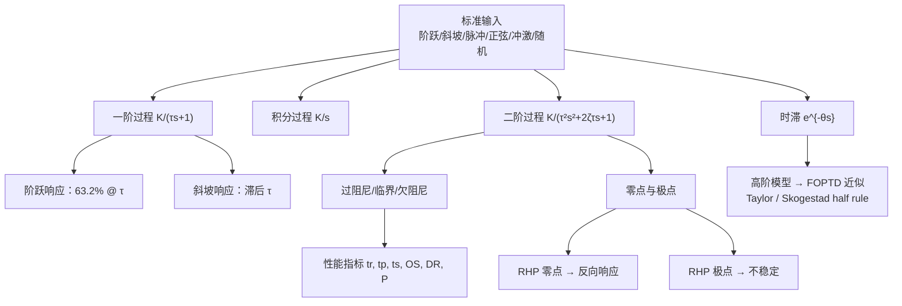

# 一阶、二阶模型与复杂过程的动态响应 / First & Second Order Models and Dynamic Response

> [!NOTE]
> **本节定位**
> - **在课程中的位置**: 第 3 周, L03（Topic 2 后半）
> - **前置知识**: [L02_laplace_transform_and_transfer_function](L02_laplace_transform_and_transfer_function.md)（Laplace 变换表、传递函数、偏差变量、线性化）
> - **本节核心**: 标准输入信号 → 一阶过程（$K,\tau$）的阶跃/斜坡响应 → 积分过程 → 二阶过程（$K,\tau,\zeta$）三种阻尼与性能指标 → 零极点对响应的影响（超调、反向响应）→ 时滞 $e^{-\theta s}$ 及高阶模型的 FOPTD 近似（Skogestad 半数规则）。
> - **后续联系**: 经验模型辨识（Topic 3）、闭环响应与稳定性（Topic 5）、PID 整定（Topic 6–7 常用 FOPTD 模型）

---

## 知识结构

---

## 知识块 1 — 课前练习：用物料/能量衡算建模

本讲开头先给了两道建模练习（衔接 Topic 1 理论模型与 [L02_laplace_transform_and_transfer_function](L02_laplace_transform_and_transfer_function.md) 的线性化）。课件**只出题，没有给解答**。

### Exercise 1：CSTR 浓度对冷却剂温度的传递函数

单一一级反应的连续搅拌釜（CSTR）：

$$V\frac{dC_A}{dt} = q(C_{Ai} - C_A) - VkC_A$$

$$V\rho C\frac{dT}{dt} = wC(T_I - T) + (-\Delta H_R)VkC_A + UA(T_c - T)$$

$$k = k_0\exp\left(\frac{-E}{RT}\right)$$

流量（$q$ 或 $w$）和进口条件（$C_{Ai}$、$T_I$）恒定。求反应器浓度 $C_A$ 对冷却剂温度 $T_c$ 变化的传递函数。

**参考解（非课件内容，sympy 推导）**

非线性项是 $k(T)C_A$，按 [L02_laplace_transform_and_transfer_function](L02_laplace_transform_and_transfer_function.md) 的 Method 1 在稳态 $(\bar C_A, \bar T)$ 处线性化。令 $\bar k = k_0e^{-E/R\bar T}$，偏差变量形式为：

$$\frac{dC_A'}{dt} = a_{11}C_A' + a_{12}T', \qquad \frac{dT'}{dt} = a_{21}C_A' + a_{22}T' + b\,T_c'$$

| 系数 | 表达式 |
|---|---|
| $a_{11}$ | $-\dfrac{q}{V} - \bar k$ |
| $a_{12}$ | $-\bar k\,\bar C_A\dfrac{E}{R\bar T^2}$ |
| $a_{21}$ | $\dfrac{(-\Delta H_R)\bar k}{\rho C}$ |
| $a_{22}$ | $-\dfrac{w}{V\rho} - \dfrac{UA}{V\rho C} + \dfrac{(-\Delta H_R)\bar k\bar C_A E}{\rho C R\bar T^2}$ |
| $b$ | $\dfrac{UA}{V\rho C}$ |

两式取 Laplace，消去 $T'(s)$：

$$\frac{C_A'(s)}{T_c'(s)} = \frac{a_{12}\,b}{s^2 - (a_{11} + a_{22})s + (a_{11}a_{22} - a_{12}a_{21})}$$

**解读**：二阶 TF。$a_{12} < 0$、$b > 0$，所以增益为负：冷却剂温度升高 → 反应器温度升高 → 反应加快 → $C_A$ 下降。

### Exercise 2：夹套冷却釜动态模型

*（此处为课件截图，未收录）*
> Fig. E2.8：进料 $T_F, q_F$ 从顶部进入搅拌釜（体积 $V$）；冷却剂 $T_i, q_J$ 泵入夹套，以 $T_J, q_J$ 流出；产品 $T, q$ 从釜底泵出。

已知条件：
1. 釜内液体体积 $V$ 和夹套内冷却剂体积 $V_J$ 恒定；$q_F$ 恒定，$q_J$ 随时间变化。
2. 热损失可忽略。
3. 釜内和夹套内都完全混合，热容都不可忽略。
4. 釜壁和夹套壁的热容可忽略。
5. 总传热系数随冷却剂流量变化：$U = Kq_J^{0.8}$（$U$ [=] Btu/h·ft²·°F，$q_J$ [=] ft³/h，$K$ = 常数）。

**参考解（非课件内容，课本补充：Seborg Exercise 2.8）**

$V$ 恒定，所以 $q = q_F$。设换热面积为 $A$。

釜内能量衡算：

$$V\rho C\frac{dT}{dt} = q_F\rho C(T_F - T) - Kq_J^{0.8}A(T - T_J)$$

夹套能量衡算：

$$V_J\rho_J C_J\frac{dT_J}{dt} = q_J\rho_J C_J(T_i - T_J) + Kq_J^{0.8}A(T - T_J)$$

两个方程、两个状态变量（$T$、$T_J$），$q_J$ 是输入，自由度为零。由于 $q_J^{0.8}$ 和 $q_J T_J$ 都是非线性项，要得到传递函数还需线性化。

---

## 知识块 2 — 标准输入信号

分析过程动态和控制系统时，要知道**过程如何响应输入的变化**。常用几种标准输入，原因有二：
1. 它们代表工厂里实际出现的变化类型；
2. 它们在数学上容易分析。

### 1. 阶跃输入（Step Input）

过程变量的**突然变化**可以近似成幅值为 $M$ 的阶跃：

$$u_S(t) = \begin{cases} 0 & t < 0 \\ M & t \ge 0 \end{cases} \tag{5-4}$$

$$U_S(s) = \frac{M}{s} \tag{5-6}$$

- 阶跃发生在任意记为 $t = 0$ 的时刻。
- **特例**：$M = 1$ 时叫"单位阶跃"，记作 $S(t)$。
- **例子**：反应器原料突然从一个供应源切换到另一个，进料浓度、流量等突然改变。

**阶跃输入例题**：第 2 章的搅拌加热槽，把加热器的电信号一调，热输入从 8000 突然变成 10,000 kcal/h：

$$Q(t) = 8000 + 2000\,S(t)$$

$$Q'(t) = Q - \bar Q = 2000\,S(t),\qquad \bar Q = 8000\text{ kcal/h}$$

阶跃幅值 $M = 2000$ kcal/h，由 (5-6) 得 $Q'(s) = 2000/s$。

### 2. 斜坡输入（Ramp Input）

工业过程常有"**漂移扰动（drifting disturbances）**"：在一段时间内缓慢地上升或下降，变化速率近似恒定。

$$u_R(t) = \begin{cases} 0 & t < 0 \\ at & t \ge 0 \end{cases} \tag{5-7}$$

$$U_R(s) = \frac{a}{s^2} \tag{5-8}$$

### 3. 矩形脉冲（Rectangular Pulse）

表示过程变量短暂、突然的变化：

$$U_{RP}(t) = \begin{cases} 0 & t < 0 \\ h & 0 \le t < t_w \\ 0 & t \ge t_w \end{cases} \tag{5-9}$$

$$U_{RP}(s) = \frac{h}{s}\left[1 - e^{-t_w s}\right] \tag{5-11}$$

*（此处为课件截图，未收录）*
> 图中画的是 $h = 1$ 的单位高度脉冲，宽度 $t_w$。

**例子**：反应器停止进料 1 小时；加热炉燃料气短暂中断。

### 4. 正弦输入（Sinusoidal Input）

过程也会受到周期性（循环）扰动，可以近似成正弦扰动：

$$u_{\sin}(t) = \begin{cases} 0 & t < 0 \\ A\sin\omega t & t \ge 0 \end{cases} \tag{5-14}$$

$$U_{\sin}(s) = \frac{A\omega}{s^2 + \omega^2} \tag{5-15}$$

$A$ = 振幅，$\omega$ = 角频率；周期 $P = 2\pi/\omega$（$\omega$ 单位为 rad/时间）。

*（此处为课件截图，未收录）*
**例子**：冷却水温度的 24 小时周期变化；60 Hz 电气噪声。

### 5. 冲激输入（Impulse Input）

$$U_I(t) = \delta(t),\qquad U_I(s) = 1$$

- 代表短暂的瞬态扰动。
- 是矩形脉冲在 $t_w \to 0$、$h = 1/t_w$ 时的极限。
- **例子**：热电偶读数里的电噪声尖峰；注入示踪染料。
- **分析上很有用**：输入为冲激时，$U(s) = 1$，所以

$$Y(s) = G(s) \tag{1}$$

> [!TIP]
> **延伸（非 PPT 内容）**
> 课件说冲激响应是 "the inverse of the TF"。准确说法是 TF 的 **Laplace 反变换**：$y(t) = \mathcal{L}^{-1}[G(s)]$，叫做**冲激响应（impulse response）**。

### 6. 随机输入（Random Input）

很多过程输入随时间变化得太复杂，无法写成确定的时间函数。若输入 $u$ 呈现明显的随机波动，就用统计量描述它：给出**均值 $\bar u$** 和**标准差 $\sigma$**。

*（此处为课件截图，未收录）*
*（此处为课件截图，未收录）*
> 左：进料流量的随机输入（在约 39–45.5 m³/h 间高频波动）与多电平输入（在约 39 和 45 两个水平间切换）。右：对应的产品浓度输出（kg/m³）。两条输出曲线都在开头冲高，之后随机输入的输出趋于平稳，多电平输入的输出持续振荡。读数为目测近似值。

---

## 知识块 3 — 一阶过程的响应

一般一阶传递函数：

$$\frac{Y(s)}{U(s)} = \frac{K}{\tau s + 1} \tag{5-16}$$

### 1. 阶跃响应

输入幅值为 $M$ 的阶跃，$U(s) = M/s$：

$$Y(s) = \frac{KM}{s(\tau s + 1)} \tag{5-17}$$

查 Table 3.1 取 $\mathcal{L}^{-1}$：

$$\boxed{y(t) = KM\left(1 - e^{-t/\tau}\right)} \tag{5-18}$$

令 $y_\infty$ 为 $y(t)$ 的稳态值，由 (5-18) 得 $y_\infty = KM$。

*（此处为课件截图，未收录）*
> Figure 5.4：一阶过程阶跃响应。$t = \tau$ 时 $y/KM = 0.632$。**$\tau$ 越大，响应越慢。**

- 经过一个时间常数（$t = \tau$），响应完成了 **63.2%**。
- 理论上输出只有在 $t \to \infty$ 时才真正到达新稳态；实际上 $t = 5\tau$ 时已经非常接近（见 Table 5.1）。

**Table 5.1 一阶过程的阶跃响应**（Python 验算 ✓）

| $t$ | $y(t)/KM = 1 - e^{-t/\tau}$ |
|---|---|
| 0 | 0 |
| $\tau$ | 0.6321 |
| $2\tau$ | 0.8647 |
| $3\tau$ | 0.9502 |
| $4\tau$ | 0.9817 |
| $5\tau$ | 0.9933 |

> [!TIP]
> **延伸（非 PPT 内容）**
> 阶跃响应在 $t = 0$ 处的初始斜率是 $KM/\tau$。如果按初始斜率一直直线上升，正好在 $t = \tau$ 时到达终值 $KM$。实验数据求 $\tau$ 时常用这一点（Topic 3 经验模型）。

### Example 5.1：搅拌加热槽

搅拌加热槽（用 Eq. 4-37 描述）预热一种含悬浮固体催化剂的反应物，流量恒定 1000 kg/h。槽内体积 2 m³，悬浮混合物密度 900 kg/m³、比热 1 cal/g·°C。初始进、出口温度分别为 100 °C 和 130 °C。

$$T'(s) = \frac{1/wC}{\frac{m}{w}s + 1}Q'(s) + \frac{1}{\frac{m}{w}s + 1}T_i'(s) \tag{4-37}$$

(a) 初始稳态的加热功率是多少？$K$ 和 $\tau$ 是多少？
(b) 加热功率突然增加 30%，槽温达到最终温度变化量的 99% 需要多久？
(c) 槽处于初始稳态时，进口温度突然从 100 °C 升到 120 °C，出口温度从 130 °C 升到 135 °C 需要多久？

课件只给了题目，**以下解答为自算**，已用 Python 验算。

**已知**：$w = 1000$ kg/h；$C = 1$ cal/g·°C $= 1$ kcal/kg·°C；$m = \rho V = 900 \times 2 = 1800$ kg；$\bar T_i = 100$ °C；$\bar T = 130$ °C。

**(a)** 稳态能量衡算 $0 = wC(\bar T_i - \bar T) + \bar Q$：

$$\bar Q = wC(\bar T - \bar T_i) = 1000 \times 1 \times 30 = \boxed{3.0\times10^4\text{ kcal/h}}$$

$$K = \frac{1}{wC} = \frac{1}{1000} = \boxed{1.0\times10^{-3}\ \text{°C·h/kcal}}, \qquad \tau = \frac{m}{w} = \frac{1800}{1000} = \boxed{1.8\text{ h}}$$

**(b)** 一阶阶跃响应：$1 - e^{-t/\tau} = 0.99 \Rightarrow t = \tau\ln 100 = 4.61\tau$。

$$t = 4.61 \times 1.8 = \boxed{8.29\text{ h}}$$

**解读**：达到 99% 的时间只取决于 $\tau$，**与阶跃幅值（30%）无关**。

**(c)** $T_i$ 到 $T$ 的增益为 1，所以 $T'(t) = 20\left(1 - e^{-t/1.8}\right)$。令 $T' = 135 - 130 = 5$ °C：

$$1 - e^{-t/1.8} = \frac{5}{20} \;\Rightarrow\; t = 1.8\ln\frac{4}{3} = \boxed{0.518\text{ h} \approx 31\text{ min}}$$

### 2. 斜坡响应

斜坡输入（5-7）、（5-8）。实际例子：
1. 把设定值以斜坡方式改到新值。（为什么不直接阶跃？）
2. 进料组成、换热器结垢、催化剂活性、环境温度的缓慢变化。

*（此处为课件截图，未收录）*
> 输入 $u(t)/a$ 是过原点、斜率为 1 的直线；输出 $y(t)/Ka$ 从零斜率起步，逐渐变成与输入平行的直线，**滞后 $\tau$**，渐近线为 $(t-\tau)S(t-\tau)$。

> [!TIP]
> **延伸（非 PPT 内容）：斜坡响应公式**
> $Y(s) = \dfrac{Ka}{s^2(\tau s+1)}$，反变换得 $y(t) = Ka\left(t - \tau + \tau e^{-t/\tau}\right)$。$t$ 很大时 $y \to Ka(t - \tau)$，这就是图中的渐近线。
>
> "为什么不直接阶跃？"——设定值突然阶跃会让控制器输出猛烈跳变，冲击阀门和设备；斜坡改变更平稳。

---

## 知识块 4 — 积分过程（Integrating Process）

并不是所有过程都有稳态增益。**积分过程（integrator）**的传递函数为：

$$\frac{Y(s)}{U(s)} = \frac{K}{s}\qquad (K = \text{constant})$$

输入幅值为 $M$ 的阶跃，$U(s) = M/s$：

$$Y(s) = \frac{KM}{s^2}\;\xrightarrow{\mathcal{L}^{-1}}\; y(t) = KMt$$

所以 $y(t)$ **无界增长，不存在新的稳态值**。

### Example 5.3：储罐液位

一个带放空口的圆柱储罐，位于槽车卸料设施和连续反应器之间，罐里的料就是反应器进料（Fig. 5.6）。反应器进料以恒定 0.02 m³/s 流出储罐。某些时段，槽车往储罐卸料，同时储罐向反应器供料。操作员必须特别小心，不能让储罐溢出或抽空。储罐高 5 m（到放空口），内截面积 4 m²。

*（此处为课件截图，未收录）*
> Figure 5.6：Tank car → Transfer pump → Storage/feed tank（顶部 Vent）→ Feed pump → Reactor。

(a) 长时间运行后，槽车卸空时罐内液位为 2 m。反应器还能运行多久储罐就会抽空？
(b) 另一辆槽车就位并接上储罐，同时继续以 0.02 m³/s 向反应器供料。如果液位刚好降到 1 m 时开始向储罐进料，槽车输送泵能开多久？假设泵开时流量恒为 0.1 m³/s。

课件只给了题目，**以下解答为自算**（Python 验算 ✓）。

**模型**：$A\dfrac{dh}{dt} = q_{in} - q_{out}$，即 $\dfrac{H(s)}{Q_{net}(s)} = \dfrac{1/A}{s}$，是一个积分过程。

**(a)** 无进料，$q_{in} = 0$：

$$t = \frac{A\,\Delta h}{q_{out}} = \frac{4 \times 2}{0.02} = \boxed{400\text{ s} \approx 6.7\text{ min}}$$

**(b)** 净流入 $0.1 - 0.02 = 0.08$ m³/s，液位从 1 m 升到 5 m：

$$t = \frac{4 \times (5 - 1)}{0.08} = \boxed{200\text{ s} \approx 3.3\text{ min}}$$

**解读**：积分过程没有"自平衡"能力，进出不平衡时液位会一直涨或一直降，所以液位必须靠控制回路或人工看守。

---

## 知识块 5 — 二阶过程的响应

### 标准形式

$$\frac{Y(s)}{U(s)} = \frac{K}{\tau^2s^2 + 2\zeta\tau s + 1} \tag{5-40}$$

三个模型参数：
- $K$ = 稳态增益
- $\tau$ = "时间常数" [=] 时间
- $\zeta$ = 阻尼系数（damping coefficient，无量纲）

等价形式（$\omega_n = 1/\tau$ 为**自然频率 natural frequency**）：

$$\frac{Y(s)}{U(s)} = \frac{K\omega_n^2}{s^2 + 2\zeta\omega_n s + \omega_n^2}$$

### 两个一阶过程串联 = 二阶过程

$$G(s) = \frac{Y(s)}{U(s)} = \frac{K_1K_2}{(\tau_1s + 1)(\tau_2s + 1)} = \frac{K}{(\tau_1s + 1)(\tau_2s + 1)} \tag{5-39}$$

Figure 5.7：两个一阶系统串联，得到一个总的二阶系统，$K = K_1K_2$。

### 三种阻尼类型

响应类型取决于阻尼系数的数值：

| 阻尼系数 | 响应类型 | 特征多项式的根 |
|---|---|---|
| $\zeta > 1$ | 过阻尼 Overdamped | 不相等的实根 |
| $\zeta = 1$ | 临界阻尼 Critically damped | 相等的实根 |
| $0 \le \zeta < 1$ | 欠阻尼 Underdamped | 共轭复根 |

*（此处为课件截图，未收录）*
- **特征多项式（characteristic polynomial）**是传递函数的分母：$\tau^2s^2 + 2\zeta\tau s + 1$。
- $\zeta < 0$ 呢？系统**不稳定**。

（课件表头写作 "Character Polynomial"，规范说法是 characteristic polynomial；页面下方这两条说明 MinerU 漏抽，已按原页补全。）

> [!TIP]
> **延伸（非 PPT 内容）：根与 ζ 的关系**
> 特征方程 $\tau^2s^2 + 2\zeta\tau s + 1 = 0$ 的根为 $s = \dfrac{-\zeta \pm \sqrt{\zeta^2 - 1}}{\tau}$。判别式 $\zeta^2 - 1$ 的正负决定根是实是复，这就是上表的来源。$\zeta > 1$ 时可分解成两个一阶串联，$\tau_1\tau_2 = \tau^2$，$\tau_1 + \tau_2 = 2\zeta\tau$。

### 阶跃响应曲线

*（此处为课件截图，未收录）*
> Figure 5.8：欠阻尼二阶过程的阶跃响应（纵轴 $y/KM$，横轴 $t/\tau$）。$\zeta = 0.2$ 时第一峰约 1.5、振荡持续很久；$\zeta = 0.4$ 峰约 1.25；$\zeta = 0.6$ 峰约 1.1；$\zeta = 0.8$ 几乎无超调。

*（此处为课件截图，未收录）*
> Figure 5.9：临界阻尼与过阻尼二阶过程的阶跃响应。都是单调上升、无超调的 S 形曲线；$\zeta$ 越大越慢（$\zeta = 1$ 约 $t/\tau \approx 8$ 到 1.0，$\zeta = 3$ 到 $t/\tau = 20$ 时约 0.96）。

**对 Fig. 5.8、5.9 的几点总结**
1. 只有 $\zeta < 1$ 时，响应才会出现振荡和超调（$y/KM > 1$）。
2. $\zeta$ 越大，响应越迟缓（sluggish）。
3. **不超调的最快响应**出现在临界阻尼 $\zeta = 1$。

（课件此页用 $\xi$，图中用 $\zeta$，是同一个阻尼系数。）

### 欠阻尼过程的性能指标

*（此处为课件截图，未收录）*
> Figure 5.10：欠阻尼阶跃响应的性能特征。$a$ = 第一峰超出新稳态的高度；$b$ = 总变化量；$c$ = 第二峰超出稳态的高度；虚线带 $0.95b \sim 1.05b$。

1. **上升时间（Rise Time）$t_r$**：输出**第一次**到达新稳态值所需的时间。
2. **到达第一峰时间（Time to First Peak）$t_p$**：输出到达第一个最大值所需的时间。
3. **调节时间（Settling Time）$t_s$**：输出进入并**保持**在一个带内所需的时间。带宽为 $y$ 总变化量的 ±5%（95% 响应时间；有些场合用 99%）。
4. **超调（Overshoot）**：$\text{OS} = a/b$（百分超调 = $100\,a/b$）。
5. **衰减比（Decay Ratio）**：$\text{DR} = c/a$（$c$ 是第二峰的高度）。
6. **振荡周期（Period of Oscillation）$P$**：相邻两个波峰（或两个波谷）之间的时间。

**调节时间例题**（课件红字）：$y_{sp} = 50$，$y_0 = 10$。

- 总变化量 $b = 50 - 10 = 40$
- ±5% 带 $= 50 \pm 0.05 \times 40 = 50 \pm 2$，即 **48 到 52**
- $t_s$ = 输出进入并保持在 [48, 52] 内的那个时刻

> [!WARNING]
> **讲义勘误（Slide 30）**
> 课件写成 "$t_s = 50 \pm 5\%$ of $b$" 和 "$t_s = 48$ to $52$"。48–52 是**输出 $y$ 的容差带**，不是时间。正确说法：$y$ 进入并一直保持在 [48, 52] 内的时刻才是 $t_s$。另外图中 "1.05b / 0.95b" 只在 $y_0 = 0$ 时成立；一般情况下带的中心是新稳态值，宽度是 ±5% × b。

> [!TIP]
> **延伸（非 PPT 内容）：性能指标与 ζ 的解析关系（Seborg Eq. 5-52 ~ 5-55）**
> $$\text{OS} = \exp\!\left(\frac{-\pi\zeta}{\sqrt{1-\zeta^2}}\right),\qquad \text{DR} = \text{OS}^2,\qquad t_p = \frac{\pi\tau}{\sqrt{1-\zeta^2}},\qquad P = \frac{2\pi\tau}{\sqrt{1-\zeta^2}}$$
>
> | $\zeta$ | OS | DR |
> |---|---|---|
> | 0.2 | 0.527 | 0.277 |
> | 0.4 | 0.254 | 0.064 |
> | 0.6 | 0.095 | 0.009 |
>
> 与 Fig. 5.8 目测峰值（1.5、1.25、1.1）一致（Python 验算 ✓）。

---

## 知识块 6 — 零点与极点

**传递函数模型的动态行为可以用它的极点和零点的数值来刻画。**

TF 的一般表示有两种等价形式：

$$G(s) = \frac{\sum_{i=0}^{m}b_is^i}{\sum_{i=0}^{n}a_is^i} \tag{4-40}$$

$$G(s) = \frac{b_m(s - z_1)(s - z_2)\cdots(s - z_m)}{a_n(s - p_1)(s - p_2)\cdots(s - p_n)} \tag{6-7}$$

- $\{z_i\}$ 是**零点（zeros）**：让分子为零的 $s$。
- $\{p_i\}$ 是**极点（poles）**：让分母为零的 $s$。
- 假设没有零极点对消，即没有哪个极点和零点数值相同。
- **复习**：物理可实现要求 $n \ge m$。

> [!WARNING]
> **讲义勘误（Slide 32）**
> "pole-zero **calculations**" 应为 "pole-zero **cancellations**"（零极点对消）。

### Example：带一个零点的过阻尼二阶过程

$$G(s) = \frac{K(\tau_a s + 1)}{(\tau_1 s + 1)(\tau_2 s + 1)} \tag{6-14}$$

求幅值为 $M$ 的阶跃响应，并定性画图。

**解**：$Y(s) = \dfrac{KM(\tau_a s + 1)}{s(\tau_1 s + 1)(\tau_2 s + 1)}$。部分分式展开（课件未写推导，以下为补充）：在 $s = -1/\tau_1$ 处的留数为 $KM\dfrac{\tau_a - \tau_1}{\tau_1 - \tau_2}$，$s = -1/\tau_2$ 处同理。得

$$y(t) = KM\left(1 + \frac{\tau_a - \tau_1}{\tau_1 - \tau_2}e^{-t/\tau_1} + \frac{\tau_a - \tau_2}{\tau_2 - \tau_1}e^{-t/\tau_2}\right) \tag{6-15}$$

（与表 3.1 第 23 行一致。）

- $y(t \to \infty) = KM$，符合预期。所以**加一个零点不改变终值，也不改变响应模态（指数项）的个数和位置**。
- 但零点会**改变各个模态在解中的权重**。

数学分析（教材 Exercise 6.3）表明有三种响应类型：

| 情况 | 条件 | 响应 |
|---|---|---|
| Case a | $\tau_a > \tau_1$ | 有超调 |
| Case b | $0 < \tau_a \le \tau_1$ | 无超调，类似一阶 |
| Case c | $\tau_a < 0$（RHP 零点） | 反向响应 inverse response |

（"响应"一列课件没写，据 Fig. 6.3 和教材补充。）

*（此处为课件截图，未收录）*
> Figure 6.3：过阻尼二阶系统（Eq. 6-14，$\tau_1 = 4$，$\tau_2 = 1$）在不同 $\tau_a$ 下的阶跃响应。$\tau_a = 16, 8$ 超调（Case a）；$\tau_a = 4$ 正好零极点对消，退化成一阶；$\tau_a = 2, 1, 0.5$ 单调（Case b）；$\tau_a = -1, -4$ 先向下再上升（Case c）。

Python 用 (6-15) 验算的特征点：

| $\tau_a$ | 极值 $y/KM$ | 出现时刻 $t$ |
|---|---|---|
| 16 | 峰值 2.75 | 2.15 |
| 8 | 峰值 1.52 | 2.60 |
| −4 | 谷值 −0.47 | 1.22 |

### 复习：零极点位置的影响

**1. 极点**

- **右半平面（RHP）极点**：这个模态随 $t$ 增大无限增长，系统**不稳定**（阶跃响应不稳定）。

*（此处为课件截图，未收录）*
> $p = a + bj$（$j = \sqrt{-1}$）。复平面上 × 位于虚轴右侧 = 不稳定极点。

- **复数极点**：解中含正弦、余弦项，响应**振荡**。

*（此处为课件截图，未收录）*
> 一对共轭复极点（左半平面）→ 稳定的振荡响应。

- **原点处的极点**（TF 中的 $1/s$ 项）：对应"**积分过程**"（知识块 4）。

**2. 零点**

- **注意：零点不影响系统稳定性。**
- **RHP 零点**：输入阶跃时产生**反向响应（inverse response）**。
- **LHP 零点**：**可能**在阶跃响应中产生"超调"（见 Fig. 6.3）。

课件 Slide 37 的 y–t 坐标里本该画反向响应曲线，但页面上只有 y = 0 的虚线，曲线漏画了。下面用 Fig. 6.3 的参数自绘一张：

*（此处为课件截图，未收录）*
> **自绘（非课件）**：$\tau_a = -4, -1$ 是 RHP 零点，输出先往"错误"方向走（低于 0），再反转趋向终值；$\tau_a = 2$ 是 LHP 零点，单调上升。

### 两个相反效应竞争导致反向响应

*（此处为课件截图，未收录）*
> Figure 6.4：两个一阶环节并联后相加，$G(s) = \dfrac{K_1}{\tau_1 s + 1} + \dfrac{K_2}{\tau_2 s + 1}$。

出现反向响应的条件：

$$-\frac{K_2}{K_1} > \frac{\tau_2}{\tau_1} \tag{6-22}$$

> [!TIP]
> **延伸（非 PPT 内容）：(6-22) 的推导与前提**
> 合并：$G(s) = \dfrac{(K_1\tau_2 + K_2\tau_1)s + (K_1 + K_2)}{(\tau_1s+1)(\tau_2s+1)}$。设 $K_1 > 0$、$K_2 < 0$、$K_1 + K_2 > 0$（慢通道 1 决定终值方向，快通道 2 方向相反）。零点在 RHP 要求 $K_1\tau_2 + K_2\tau_1 < 0$，整理就是 (6-22)。**课件省略了这些前提条件**，不加前提时这个不等式不普遍成立。
>
> 物理例子：锅炉汽包加冷水，水位先因气泡塌缩下降（快效应），再因水量增加上升（慢效应）。

---

## 知识块 7 — 含时滞的过程

时滞（time delay，也叫 dead time）来自：
1. 管道中的流体流动；
2. 固体物料的输送（例如传送带）；
3. 化学分析：取样管线延迟；做分析需要的时间（例如在线气相色谱）。

**数学描述**：输入 $u$ 和输出 $y$ 之间有时滞 $\theta$：

$$y(t) = \begin{cases} 0 & t < \theta \\ u(t - \theta) & t \ge \theta \end{cases} \tag{6-27}$$

### Example 6.5：湍流管道

令 $u$ = 点 1 处的流体性质（例如温度或组成），$y$ = 点 2 处的流体性质。

*（此处为课件截图，未收录）*
> Figure 6.5：湍流管道输送。假设速度剖面是"平"的（截面上速度均匀，即平推流 plug flow）。

*（此处为课件截图，未收录）*
> Figure 6.6：**时滞的效果就是函数在时间轴上平移**。输出 $y(t)$ 与输入 $x(t)$ 形状完全相同，只是整体右移 $\theta$。

**题目**：对 Fig. 6.5 的管段，求传递函数：(a) 点 2 液体质量流量 $w_2$ 与点 1 质量流量 $w_1$ 之间；(b) 点 2 某组分浓度与点 1 浓度之间。液体不可压缩。

**(a)** 对管段做总物料衡算。不可压缩流体不可能累积：

$$\text{物料进} = \text{物料出} \;\Rightarrow\; w_1(t) = w_2(t)$$

写成偏差形式取 Laplace：

$$\frac{W_2'(s)}{W_1'(s)} = 1$$

**(b)** 观察时刻 $t$ 经过点 1 的一个极小流体微元，体积为 $V$，含所研究组分 $Vc_1(t)$。若它在 $t + \theta$ 时刻经过点 2，含 $Vc_2(t + \theta)$。平推流时微元不与相邻流体混合，所含组分的量不变：

$$Vc_2(t + \theta) = Vc_1(t) \tag{6-30}$$

$$c_2(t + \theta) = c_1(t) \tag{6-31}$$

流量恒定时，等价写成：

$$c_2(t) = c_1(t - \theta) \tag{6-32}$$

写成偏差形式取 Laplace（用 Table 3.1 第 5、26 项，即平移定理）：

$$\boxed{\frac{C_2'(s)}{C_1'(s)} = e^{-\theta s}} \tag{6-33}$$

> [!WARNING]
> **讲义勘误（Slides 42–43）**
> - 题干中的 "$w_t$" 应为 **$w_1$**。
> - Slide 43 开头说 "Putting (6-30) in deviation form" 得到 $W_2'/W_1' = 1$，指的是 $w_1 = w_2$；但同页又把 (6-30) 贴在 $Vc_2(t+\theta) = Vc_1(t)$ 上。编号自相矛盾。按教材，$w_1 = w_2$ 应为 (6-30)，后面的浓度式顺延（请核实）。

> [!TIP]
> **延伸（非 PPT 内容）**
> 平推流管道的时滞 $\theta$ = 管内体积 ÷ 体积流量 = $\dfrac{AL}{q}$（$A$ 为截面积，$L$ 为管长）。课件只说了 "if the flow rate is constant"，没有给出 $\theta$ 的表达式。

### 时滞的传递函数

$$\frac{Y(s)}{U(s)} = e^{-\theta s} \tag{6-28}$$

$\theta$ 的单位是时间（例如分钟、小时）。

---

## 知识块 8 — 时滞的多项式近似与高阶模型降阶

### $e^{-\theta s}$ 的多项式近似

为了用解析方法处理传递函数，常把 $e^{-\theta s}$ 近似成多项式（MATLAB 等仿真软件里也常用）。最常用的是 **Taylor 级数展开**：

$$e^{-\theta s} = 1 - \theta s + \frac{\theta^2s^2}{2!} - \frac{\theta^3s^3}{3!} + \frac{\theta^4s^4}{4!} - \cdots \tag{6-34}$$

截取前几项即得近似。

课件后面引用的 (6-57)、(6-58) 没有给出公式本身。按教材（**课本补充，请核实**）：

$$e^{-\theta s} \approx 1 - \theta s \tag{6-57}$$

$$e^{-\theta s} = \frac{1}{e^{\theta s}} \approx \frac{1}{1 + \theta s} \tag{6-58}$$

**解读**：(6-57) 说明一个 RHP 零点 $(1 - \theta s)$ 可以近似成时滞 $\theta$；(6-58) 说明一个小时间常数 $\theta$ 的一阶滞后可以近似成时滞 $\theta$。

（课件中 "Matrix" 原文如此，可能指 MATRIXx 软件。MinerU 抽取的 full.md 里把这一页的 $e^{-\theta s}$ 误识成 $e^{-6s}$，查原文时注意。）

### Skogestad 半数规则（"half rule"）

- Skogestad (2002) 提出了一种针对含多个时间常数的高阶模型的近似方法。
- 他这样处理**被忽略的最大时间常数**：**一半加到现有的时滞上（如果有），另一半加到保留下来的最小时间常数上。** s
- 比"被忽略的最大时间常数"还小的时间常数，用 (6-58) 近似成时滞。

### Example 6.4：高阶模型的 FOPTD 近似

$$G(s) = \frac{K(-0.1s + 1)}{(5s + 1)(3s + 1)(0.5s + 1)} \tag{6-59}$$

求一阶加时滞（first-order-plus-time-delay, FOPTD）近似模型：

$$\tilde G(s) = \frac{Ke^{-\theta s}}{\tau s + 1} \tag{6-60}$$

用两种方法：(a) Eq. 6-57、6-58 的 Taylor 近似；(b) Skogestad 半数规则。比较 $G(s)$ 与近似模型对单位阶跃的归一化响应。

**(a) Taylor 近似**：保留主导时间常数 5。
ss
$$-0.1s + 1 \approx e^{-0.1s} \tag{6-61}$$

$$\frac{1}{3s + 1} \approx e^{-3s},\qquad \frac{1}{0.5s + 1} \approx e^{-0.5s} \tag{6-62}$$

代入 (6-59)：

$$\tilde G_{TS}(s) = \frac{Ke^{-0.1s}e^{-3s}e^{-0.5s}}{5s + 1} = \boxed{\frac{Ke^{-3.6s}}{5s + 1}} \tag{6-63}$$

**(b) Skogestad 半数规则**：被忽略的最大时间常数是 3。

- 一半加到下一个最大的时间常数上：$\tau = 5 + 0.5(3) = 6.5$
- 另一半成为时滞：$0.5(3) = 1.5$
- RHP 零点按 (6-61) 再贡献时滞 0.1
- 最小时间常数 0.5 按 (6-58) 再贡献时滞 0.5

$$\theta = 1.5 + 0.1 + 0.5 = 2.1$$

$$\tilde G_{Sk}(s) = \boxed{\frac{Ke^{-2.1s}}{6.5s + 1}} \tag{6-64}$$

*（此处为课件截图，未收录）*
> Figure 6.10：实际模型与两个近似模型的归一化阶跃响应比较。**Skogestad 法与实际响应吻合得更好**；Taylor 法时滞偏大（3.6），起步明显偏晚。

Python 数值比较（$K = 1$，单位阶跃）：

| 模型 | $y(5)$ | $y(10)$ |
|---|---|---|
| 实际 $G(s)$ | 0.309 | 0.683 |
| Skogestad | 0.360 | 0.703 |
| Taylor | 0.244 | 0.722 |

（课件 Slide 47 说一半加到 "smallest retained time constant"，Slide 50 说加到 "next largest time constant"。本题只保留一个时间常数 5，两种说法结果相同。）

---

## 对比与总结

| 对比维度 | 一阶过程 | 积分过程 | 二阶过程 |
|---|---|---|---|
| TF | $\dfrac{K}{\tau s+1}$ | $\dfrac{K}{s}$ | $\dfrac{K}{\tau^2s^2+2\zeta\tau s+1}$ |
| 参数 | $K, \tau$ | $K$ | $K, \tau, \zeta$ |
| 阶跃响应终值 | $KM$ | 无界（$KMt$） | $KM$ |
| 特点 | 63.2% @ $\tau$，无超调 | 无自平衡 | $\zeta<1$ 才超调振荡 |
| 极点 | $-1/\tau$ | 原点 | 由 $\zeta$ 决定实/复 |

| 对比维度 | Taylor 近似 | Skogestad 半数规则 |
|---|---|---|
| 被忽略的时间常数 | 全部变成时滞 | 最大者一半给 $\tau$、一半给 $\theta$ |
| Example 6.4 结果 | $Ke^{-3.6s}/(5s+1)$ | $Ke^{-2.1s}/(6.5s+1)$ |
| 精度 | 时滞偏大，起步偏晚 | 更接近实际 |

---

## 本节引入的核心概念

- First-Order Process、Time Constant、Integrating Process
- Second-Order Process、Damping Coefficient、Overshoot、Decay Ratio、Settling Time
- Poles and Zeros、Inverse Response
- Time Delay、FOPTD Model、Skogestad Half Rule

---

## 我的疑问

> [!NOTE]
> 1. Exercise 1 的二阶 TF 何时会出现复根（振荡）？和放热反应的热失控（[L01_intro_to_process_control](L01_intro_to_process_control.md) 知识块 4）有什么联系？
> 2. 调节时间用 ±5% 还是 ±2%（99%）？考试按哪个标准？
> 3. Skogestad 半数规则里 "added to the smallest retained time constant" 和 "next largest time constant" 在保留多个时间常数时结果不同，应以哪种为准？
> 4. 什么情况下 FOPTD 近似不够用，要改成二阶加时滞（SOPTD）？

---

## 个人补充

> [!NOTE]
> **我的理解**
> 
